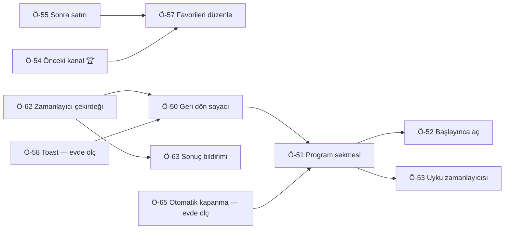

# 🔭 scm-editor — Geliştirme Tarama Raporu (odak: kumanda)

**Tarih**: 17.10.2026 · **Proje Tipi**: Node ajanı (pi63) + web kumandası (`aqara` paneli içinde, `kumanda.ibrahimyagci.com`) · **Sınıf**: Orta, odak modu

> Bu koşunun odağı kullanıcının sorusu: **"kumandaya ekleyebileceğimiz özellikler"** — özellikle
> zamanlamalı kanal değişimi ("reklam oldu, 8 dk sonra şu kanalı aç") ve tarih/saatli, tekrarlı
> programlama (ayrı sekme). Kanal listesi düzenleme tarafı (önceki koşuların konusu) kısaca geçilir.
> Önceki rapor: `scm-editor_tara_20261013.md`.

## 0. Önceki Taramadan Bu Yana (13.10.2026 defteri, 49 öneri)

| Durum | Sayı | Notlar |
|---|---|---|
| ✅ Yapıldı | 19 | 13.10'dan beri listeden yeni kapanan yok (Ö-29/30/31/49 zaten 14.10'da kapanmıştı) |
| 🔓 Açık | 15 | Ö-34 sıra kayması tespiti (36), Ö-33 "Sıram" sayfası (30), Ö-38 anahtar/cihaz kimliği (27), **Ö-40 public depoda cihaz kimliği hijyeni (27)**, Ö-36 oda TV tuş haritası (kısmen: oda TV artık ağdan kumanda ediliyor) |
| 🚫 Vazgeçildi | 15 | — |

Listenin dışında bu arada yapılanlar (kullanıcı istekleri, 15-17.10): ev panelinde TV kumandası,
yayın rehberi (digiturk, yedek tvplus), Wake-on-LAN ile kapalı TV'yi açma, uyanan TV'de kanalın ekrana
gelmesinin doğrulanması, Apple TV ↔ Canlı TV geçişi, `kumanda.ibrahimyagci.com` (ayrı şifre, kaba kuvvet
kilidi). 15.10'daki "hızlı erişim" taramasının raporu yazılmamıştı; o konu artık uygulanmış durumda ve bu
rapor onun yerine geçer.

## 1. Kumanda Bugün Ne Durumda (kısa)

- Telefondan iki LG TV: ⏻ (kapalıyken açar), Apple TV ↔ Canlı TV, 🔇, **Ch / Vol** penceresi, önizleme,
  7 favori kanal (adla; altında şu anki yayın + ilerleme çubuğu), Ana · Bilgi · Geri · Ayarlar · Çıkış,
  renk tuşları. Yerleşim kullanıcının tasarımı (17.10.2026).
- Yol: telefon → VPS (`kumanda.js` + `tvKumanda.js`) → Tailscale → pi63 `tv-ajan` → TV. Ajan izin
  listesiyle çalışır, ham SSAP geçişi yok.
- Güçlü yanları: favori kanala basınca **kapalı TV açılıp o kanala geçiyor ve kanalın gerçekten ekrana
  geldiği doğrulanıyor**; rehber TV kapalıyken de çalışıyor; iki TV tek ekranda.
- Eksik olan, kullanıcının sorduğu: **zaman**. Kumanda yalnız "şimdi" diyebiliyor.

## 2. 🌍 Dış Dünya: Benzer Projeler ve Pazar

### Benzer GitHub Projeleri (hepsi son 2 ayda commit almış; künye GitHub API, 17.10.2026)

| Proje | ⭐ | Son commit | Öne çıkan |
|---|---:|---|---|
| home-assistant/core `webostv` (+ aiowebostv) | 91 572 | 15.10.2026 | servisler (tuş, ham komut, ses çıkışı), toast bildirimi, ekranı kapat, durum push |
| klattimer/LGWebOSRemote | 660 | 04.10.2026 | ~60 komutluk CLI, WOL, toast, ekranı kapat, resim modu |
| chros73/bscpylgtv | 365 | 30.09.2026 | en geniş yüzey; ekran görüntüsü; G5 ayar dökümünde TV'nin kendi zamanlayıcıları |
| hobbyquaker/lgtv2mqtt | 114 | 15.10.2026 | MQTT köprüsü; toast, metin girişi, ses çıkışı |
| JPersson77/LGTVCompanion | 1 461 | 22.08.2026 | PC olaylarına bağlı otomasyon (saat bazlı değil) |
| merdok/homebridge-webos-tv | 706 | 11.09.2026 | **kapalı TV'de kanal düğmesi önce açar**, makro, bildirim düğmeleri |
| grzegorz914/homebridge-lgwebos-tv | 169 | 17.10.2026 | REST/MQTT, webOS 24+/26 tuzaklarını kodda belgeliyor |
| madmicio/LG-WebOS-Remote-Control (HA kartı) | 588 | 08.05.2026 | arayüz olarak bize en yakın; **lisansı yok** → yalnız fikir |

### Özellik Karşılaştırma Matrisi
*(her hücre repo README/koduna bakılarak dolduruldu — ayrıntı ve dipnotlar ajan dosyasında; ◐ = kısmi/dolaylı)*

| Özellik | **Bizim** | HA | LWR | bsc | l2m | LTC | merdok | grz | kart |
|---|:---:|:---:|:---:|:---:|:---:|:---:|:---:|:---:|:---:|
| Güç aç (WOL) | ✅ | ◐ | ✅ | ❌ | ✅ | ✅ | ✅ | ✅ | ✅ |
| Kapalı TV'de kanala basınca aç + kanal | ✅ (+ doğrulama) | ❌ | ❌ | ❌ | ❌ | ❌ | ✅ | · | ❌ |
| Kanalı adla açma | ✅ | ✅ | ◐ | ◐ | ✅ | 🔧 | ✅ | ✅ | ✅ |
| Favori kanal pedi | ✅ | ❌ | ❌ | ❌ | ❌ | ❌ | ✅ | ✅ | ✅ |
| "Şu an ne var" + ilerleme | ✅ (dış rehber) | ◐ | ❌ | ✅ | ◐ | 🔧 | · | ◐ | ❌ |
| Ekran görüntüsü önizleme | ✅ | ❌ | ❌ | ✅ | ❌ | 🔧 | ❌ | ❌ | ❌ |
| Çoklu TV | ✅ | ✅ | ✅ | ✅ | ✅ | ✅ | ✅ | · | ✅ |
| TV ekranına bildirim (toast) | ❌ | ✅ | ✅ | ✅ | ✅ | 🔧 | ✅ | ✅ | ❌ |
| Ekranı kapat, ses açık | ❌ | ✅ | ✅ | ✅ | ✅ | ✅ | ✅ | ✅ | · |
| Mutlak ses / ses sınırı | ❌ | ✅/❌ | ✅/❌ | ✅/❌ | ✅/❌ | ✅/❌ | ✅/✅ | ✅/· | ❌ |
| Ses çıkışı seçimi | ❌ | ✅ | ✅ | ✅ | ✅ | ✅ | ✅ | ✅ | ✅ |
| Uygulama başlatıcı | ❌ | ✅ | ✅ | ✅ | ✅ | ✅ | ✅ | ✅ | ✅ |
| Tuş makrosu | ❌ | ◐ | ❌ | ◐ | ❌ | ◐ | ✅ | · | ❌ |
| **Zamanlama / uyku zamanlayıcısı (proje içinde)** | ❌ | ❌ | ❌ | ❌ | ❌ | ◐ | ❌ | ❌ | ❌ |

**En önemli dış bulgu:** incelenen 9 projenin **hiçbirinde** "saat X'te kanal Y", "N dk sonra aç" ya da
uyku zamanlayıcısı yok; hepsi bunu Home Assistant/HomeKit/MQTT otomasyonuna bırakıyor [A]. Kullanıcının
istediği özellik benzerlerinde olmayan, kumandayı ayıran bir özellik olur.

### Pazar ve kullanıcılar ne istiyor
- **Reklam arası dönüşü eski ve kanıtlı bir fikir:** UEI'nin "Media return system" patenti (öncelik 2000)
  kumandada "tipik reklam arası süresi kadar basit bir zamanlayıcı" kurup süre dolunca kanala dönmeyi
  anlatıyor; Dish/EchoStar'ın 2014 başvurusu ara bitmeden ekranda "geri dön / iptal" gösteriyor [B].
  Bizim "8 dk sonra Kanal D'ye dön" fikrinin bire bir öncülü.
- **"Başlayınca aç" (hatırlatıcı) TV dünyasında standart:** LG rehberinde WATCH/REMINDER, Samsung TV Plus,
  Kodi. Kodi'nin modeli en iyisi: hatırlatma ekranda çıkar, kimse tepki vermezse kanal kendiliğinden
  değişir [B]. LG ayrıca rehber saatlerinin kesin olmadığını yazıyor → birkaç dakikalık tolerans gerek [B].
- **Uygulamada yaşayan zamanlayıcı çalışmaz:** Channels DVR hatırlatıcıyı "uygulama çalışmıyorsa hiçbir
  şey yapamıyor" ve "az kullanıldı" diye kaldırmış (K3) [B]. Bizde zamanlayıcı 7/24 açık pi63'te çalışır;
  "az kullanıldı" dersi: özellik ayrı bir menüye gömülmemeli, **görülen yere** (kumanda ekranı, kanal
  kutusu) konmalı.
- **Hiçbir Node zamanlayıcı kütüphanesi kalıcılık sağlamıyor** (node-cron, cron, node-schedule, croner);
  kesintide kaçan görevi kimse çalıştırmıyor [B]. Kalıcılık ve kaçırma politikası bizim kodumuzda olmalı.
- **iPhone ana ekran uygulaması** Safari'den ayrı çerez tutar (girişi bir kez de içinde yapmak gerekir),
  ITP'nin 7 gün silme kuralından muaftır, sunucunun koyduğu birinci taraf kalıcı çerezin ömrünü kısmaz [C].

## 3. 🎯 Önerilen Yeni Özellikler (kullanıcı için)

### Ö-50: ⏱ "Geri dön" — reklam arası sayacı — 🔴
- **Ne**: Kumandada tek düğme: "**X dk sonra şu kanala dön**". Hedef varsayılan olarak *şu an açık kanal*
  (reklamda başka kanala kaçıp geri dönme alışkanlığı). Hazır süreler çip: **3 · 5 · 8 · 10 · 15 dk**, son
  seçilen hatırlanır. Başlayınca üstte geri sayım bandı: "Kanal D'ye dönülecek · 07:42 · [+1 dk]
  [Şimdi dön] [İptal]". TV başına tek sayaç; yenisi eskisinin yerine geçer.
- **Neden**: Kullanıcının doğrudan isteği; UEI/Dish patentleri ve TV kutularındaki "geç / iptal" kalıbı [B].
- **Nasıl (taslak)**: Sayaç **pi63 ajanında** çalışır (telefon kilitlense de çalışsın) → Ö-62 çekirdeği
  üzerine bir "göreli tek seferlik görev" (`an = şimdi + X`, mutlak an saklanır). UI: `public/tv.js` ana
  satıra düğme + bant; panel `tvKumanda.js` → ajan `POST /zamanlayici`.
- **Güven**: ✅ (kullanıcı isteği + ≥2 bağımsız kaynak) · **Skor**: E5×G3×K2 = **30**

### Ö-51: 📅 "Program" sekmesi — tarih/saatli ve tekrarlı kanal açma — 🔴
- **Ne**: Ayrı sekme. Form sırası: **TV → kanal → Bir kez / Tekrarla → (tarih) saat → günler (Her gün ·
  Hafta içi · Hafta sonu · Özel) → TV kapalıysa (Aç / Atla) → Kaydet**. Üstte **Yaklaşanlar** (en yakın
  üstte, "35 dk sonra" gibi), her satırda aç/kapa ve sil; altta **Geçmiş** (son 20: ✓ yapıldı · ⚠ kaçırıldı
  · ✗ hata + neden).
- **Neden**: Kullanıcının isteği ("tek sefer, her gün, her hafta vs vs, ayrı sekme"). Model HA
  scheduler-card'ın Repeat/Stop/Delete ve "Every day / Workdays / Weekend / Custom" yapısının karşılığı
  (GPL — kod alınmaz, yalnız model) [B].
- **Nasıl**: Ö-62 çekirdeği + `tv.html`'e sekme (çerçevesiz, basit hash sekmesi). Hedef TV formda seçili
  TV'den dolar.
- **Güven**: ✅ · **Skor**: E5×G3×K2 = **30**

### Ö-52: 🔔 "Başlayınca aç" — rehberden programa bağlı görev — 🔴
- **Ne**: Kanal kutusunda/rehberde bir programa dokun → "Başlayınca aç". Tek seferlik görev, adıyla
  listelenir ("Kızıl Goncalar · Show TV · 21:07"). İkinci aşama **dizi kuralı**: "bu programı her hafta
  aç" — rehber tazelendikçe program adına göre yeniden hizalanır (yayın günü kayarsa da tutar; 16.10'da
  bir programın cumaya alındığı görülmüştü).
- **Neden**: Piyasada standart ve beğenilen (LG, Samsung, Kodi) [B]. **Rehber 7 gün ileriyi veriyor**
  (17.10.2026 ölçümü: bugün + 6 gün dolu, 7. gün boş) → bir hafta içindeki her program seçilebilir.
- **Nasıl**: `rehber.mjs`'e program arama (`ara(ad, gün)`); görev `kaynak: epg {kanal, program, bas, bit}`,
  tolerans `min(bas + 5 dk, bitiş)`.
- **Güven**: ✅ · **Skor**: E4×G3×K2 = **24**

### Ö-53: 😴 Uyku zamanlayıcısı — 🔴
- **Ne**: "30/60/90 dk sonra kapat" ve **"bu program bitince kapat"** (rehberdeki bitiş saatiyle).
- **Neden**: Benzer projelerde yok [A]; TV'nin kendi `sleepTimer` ayarı G5 dökümünde görünüyor ama
  yazılabildiği doğrulanmamış ve eski yolu ekranda diyalog gösteriyor [A] → kendi zamanlayıcımız daha
  güvenilir.
- **Nasıl**: Ö-62 görev türü `eylem: kapat`. Kapatmadan 60 sn önce TV'ye toast (Ö-58).
- **Güven**: 🟡 · **Skor**: E4×G2×K3 = **24**

### Ö-54: ↺ Önceki kanal — 🔴 Quick Win 🏆
- **Ne**: Tek dokunuşla bir önceki kanala dön (reklamda iki kanal arasında gidip gelmek).
- **Neden**: İç analiz; Ö-50'nin "anında" hâli, en sık hareket.
- **Nasıl**: Ajan `kanalAc`'ta TV başına son kanalı tutar (`Tv.oncekiKanal`), `POST /kanal {onceki:true}`.
  UI'da Ch / Vol yanına ya da önizleme köşesine "↺".
- **Güven**: 🟡 · **Skor**: E4×G2×K3 = **24**

### Ö-55: "Sonra:" satırı kanal kutusunda — 🔴
- **Ne**: Her kutuda ilerleme çubuğunun altına "Sonra 21:00 · Program adı".
- **Neden**: Veri zaten geliyor (`/epg` → `sonraki`) ama yalnız fare üzerine gelince (title) görünüyor;
  telefonda hiç görünmüyor (kodda doğrulandı).
- **Nasıl**: `tv.js` → `favorileriCiz` bir satır; Ö-52'nin dokunma hedefi de bu satır olur.
- **Güven**: ✅ · **Skor**: E3×G3×K3 = **27**

### Ö-57: Favorileri arayüzden düzenle — 🔴
- **Ne**: "Favori kanallar" başlığında ✎: ekle (TV'nin kanal listesinde adla arama), çıkar, sürükle-sırala.
- **Neden**: Liste bugün kodda sabit (`tvKumanda.js` → `FAVORI_KANALLAR`); her değişiklik yayın gerektiriyor.
- **Nasıl**: Liste panelde JSON dosyasında (`aqara` veri dizini) ya da ajanda; ajan `/kanallar` zaten var.
- **Güven**: ✅ · **Skor**: E4×G3×K2 = **24**

### Ö-56: ▶ Canlı önizleme — 🟡
- **Ne**: Önizlemede "▶ Canlı" → saniyede ~1,5-2 karelik akış; 2 dk sonra ya da sayfa gizlenince durur.
- **Neden**: Kullanıcı sordu ("daha akışkan olabiliyor mu"). **Ölçüm (17.10.2026, salon):** ajan bir kareyi
  ~0,40 sn'de alıyor (~100 KB, 960×540) → üst sınır ~2,5 kare/sn; bulut üzerinden ayrı isteklerle ~0,8 sn.
  Tek sürekli akışla (multipart JPEG) kare çekimi ile aktarım üst üste biner. Gerçek video bu yoldan yok.
- **Nasıl**: Ajan `GET /ekran-akis?tv=` (multipart/x-mixed-replace), panel akışı geçirir, `` gösterir.
  Veri: ~12 MB/dk → yalnız isteğe bağlı ve süre sınırlı.
- **Güven**: ✅ (ölçüldü) · **Skor**: E3×G3×K2 = **18**

### Ö-58: TV ekranına bildirim (toast) — 🟡
- **Ne**: Zamanlı geçişten 10 sn önce TV'de "Kanal D'ye geçiliyor" (Kodi modeli); uyku zamanlayıcısında
  "1 dk sonra kapanacak". Genel kullanım: telefondan TV'ye kısa mesaj.
- **Neden**: 8 projede var (`ssap://system.notifications/createToast`) [A]; eşleşme izinlerimizde
  `WRITE_NOTIFICATION_TOAST` var (kodda doğrulandı). Yeni firmware'de ikon yok sayılıyor → ikonsuz [A].
- **Nasıl**: Ajana `toast(mesaj)`; zamanlayıcı tetiklemesinde kullanılır. **Bizim TV'lerde ölçülmedi.**
- **Güven**: 🟡 · **Skor**: E3×G2×K3 = **18**

### Ö-59: Ekranı kapat, ses açık — 🟡
- **Ne**: Haber/müzik dinlerken ekranı karart (OLED'i de korur), dokununca geri aç.
- **Neden**: 7 projede var; `ssap://com.webos.service.tvpower/power/turnOffScreen` [A]. ⚠️ bir kaynakta
  yanlış parametreyle ekranın geri açılamadığı yazıyor → yalnız parametresiz çağrı.
- **Güven**: 🟡 (bizde ölçülmedi) · **Skor**: E3×G2×K3 = **18**

### Ö-61: Kısayollar / Siri / Eylem Düğmesi için dar uç — 🟡
- **Ne**: "Hey Siri, salonda Kanal D" ya da iPhone Eylem Düğmesi → kanal. İleride Aqara düğmesi de aynı uca.
- **Neden**: Kısayollar "URL içeriğini al" ile POST + JSON gönderebiliyor, Eylem Düğmesi kısayol
  çalıştırabiliyor [C]. Kumanda HTTPS'te olduğu için telefonda Tailscale gerekmez.
- **Nasıl**: Panelde ayrı, iptal edilebilir belirteçli `POST /api/kisayol/<eylem>` (oturum çerezinden
  bağımsız; yalnız izinli eylemler). Başlıkta belirteç göndermenin Apple belgesi yok, topluluk kaynaklı [C].
- **Güven**: 🟡 · **Skor**: E4×G2×K2 = **16**

### Ö-60: Ses seviyesi göstergesi + gece üst sınırı — 🟡
- **Ne**: Ch / Vol penceresinde ses sayısı; isteğe bağlı üst sınır.
- **Neden**: `audio/getVolume`/`setVolume` [A]; merdok'ta `volumeLimit` [A]. Soundbar/ARC'de ses −1
  dönebilir → o durumda yalnız ±.
- **Güven**: ✅ · **Skor**: E2×G3×K2 = **12**

## 4. 🔧 Kod ve Mimari İyileştirmeleri

### Ö-62: Zamanlayıcı çekirdeği ajanın içinde — 🔴 (Ö-50…53'ün temeli)
- **Ne**: Tek dosya `/var/lib/tv-ajan/zamanlayici.json` (atomik yazım: `.tmp` + `rename`, rehberle aynı
  kalıp); **mutlak an** saklanır ("8 dk" yeniden başlatmada baştan sayılmaz); **30 sn duvar saati döngüsü**
  (kütüphanesiz); en fazla 50 görev; her çalıştırma `kanalTuttuMu` ile doğrulanır, doğrulanmazsa `hata`.
- **Kaçırma politikası — "son tarihli hemen çalıştır"**: tolerans içindeyse **bir kez** çalıştır, dışındaysa
  atla ve bildir: göreli 2 dk · rehber `min(başlangıç + 5 dk, bitiş)` · tek/haftalık 5 dk; haftalıkta
  sonraki anı hesapla, geriye dönük birden fazla çalıştırma yok. Aynı TV'ye çakışan görevlerde yalnız en
  son vadeli çalışır.
- **Neden**: Hiçbir Node kütüphanesi kalıcılık/kaçırma vermiyor [B]; Node `setTimeout` ~24,8 günden uzun
  gecikmede hemen ateşleniyor [B]; endüstri modelleri systemd `Persistent=`, Kubernetes
  `startingDeadlineSeconds`, Quartz `FIRE_NOW` [B].
- **Kesinti tespiti**: dakikada bir `sonCanli` damgası (HA scheduler-component kapanış zamanını yalnız temiz
  kapanışta yazıyor → elektrik kesintisinde bilgi yok) [B]; açılışta saat geride görünüyorsa NTP beklenir.
- **Güven**: ✅ · **Skor**: E5×G3×K2 = **30**

### Ö-63: Sonuç insana ulaşsın — kaçırılan/başarısız görev telefona — 🔴
- **Ne**: `kacirildi` ve `hata` sonuçları telefona bildirim; `ok` isteğe bağlı.
- **Neden**: Ekosistem kuralı: "exit 0 kanıt değil", log kanal sayılmaz (`KURALLAR.md` § 7).
- **Nasıl**: Ajan → panel `POST /api/agent/tv-olay` (pi63 ajanlarının bugünkü bearer kalıbı) → panelin
  mevcut web push'u (yeni konu "TV zamanlayıcı"). iOS web push şartları zaten panelde karşılanıyor [B][C].
  Bark yedek.
- **Güven**: ✅ · **Skor**: E4×G3×K2 = **24**

### Ö-65: Uyandırılan TV kendiliğinden kapanıyor mu — ölç — 🟡
- **Ne**: Zamanla açılan TV dokunulmazsa kapanabilir: LG, *Power On Timer* ile açılan TV'nin 2-4 saat girdi
  olmazsa kapandığını ("4 Hours Auto Power Off") resmî olarak yazıyor; WOL ile açılan TV ya da ağdan gelen
  komutların sayacı sıfırlayıp sıfırlamadığı için **kaynak yok** [D]. Ayrıca sinyalsiz HDMI'da 15 dk
  kalan TV kapanıyor [D].
- **Nasıl**: Evde: TV'yi ağdan aç, dokunma, kapanma saatini ajan kaydından oku. Sonuca göre ya hiçbir şey
  ya "otomatik kapanma ayarını kapat" önerisi.
- **Güven**: 🟡 · **Skor**: E3×G2×K3 = **18**

### Ö-64: Durum için yoklama yerine abonelik — 🟡
- **Ne**: 20 sn'lik durum yoklaması yerine TV'nin bildirdiği değişiklikler (ön plandaki uygulama, kanal, güç).
- **Neden**: HA ve lgtv2 böyle çalışıyor [A]; kumanda değişikliği anında gösterir, gereksiz istek azalır.
- **Güven**: ✅ · **Skor**: E2×G3×K2 = **12**

## 5. 🔐 Güvenlik Önerileri

### Ö-67: Zamanlayıcı uçlarına sınır — 🟡
- **Ne**: En fazla 50 görev; yalnız izinli eylemler (kanal, kapat, giriş) ve TV listesinde bulunan
  kanallar; panel ve ajan ayrı ayrı doğrular (bugünkü iki katlı desen); gece (00-07) TV **açan** görev
  formda açık uyarı ister.
- **Neden**: Zamanlayıcı, kumandayı ilk kez "kimse bakmazken iş yapan" bir sisteme çevirir; yanlış ya da
  kötü niyetli bir görev gece TV açabilir.
- **Güven**: ⚪ · **Skor**: E3×G1×K3 = **9**

### Ö-66: Misafir girişte yetkiyi daralt — 🟢
- **Ne**: Tek oturumluk (misafir) şifreyle kumanda kullanılır ama Program sekmesine yazılamaz,
  zamanlayıcı kurulamaz.
- **Güven**: ⚪ · **Skor**: E3×G1×K3 = **9**

> Not — **Ö-40** (önceki koşudan, açık): public depoda üç dökümde TV seri numarası duruyor; karar kullanıcıda.

## 6. 💡 Yenilikçi / Cesur Fikirler

- **Reklam süresini ekrandan okumak.** 17.10'da önizlemede Kanal D'nin reklam öncesi köşede geri sayım
  gösterdiği görüldü ("01:45 → 00:00"). Ekran görüntüsünden bu sayacı okuyup "Geri dön" süresini
  kendiliğinden kurmak mümkün olabilir. Ses/görüntü analiziyle reklam algılama (2013 "Commercial Break"
  uygulaması) pahalı [B]; kanalın kendi sayacını okumak çok daha ucuz.
- **Apple TV kontrolü.** pyatv bugün tuşları, "şu an ne oynuyor"u, uygulama açmayı ve gücü destekliyor
  [C]. Ama: bakım yavaş (son sürümden beri birleştirilen PR yok), tvOS 26/27'de açık sorunlar var ve **Apple
  TV'ye giden her istek cihazı uyandırıyor** → canlı yayındayken TV'nin girişini kendine çekebilir [C].
  Denenecekse önce evde ölçülmeli, tek kalıcı bağlantıyla.
- **Çoklu Görüntü kısayolu** ("Kanal D + Apple TV yan yana"): TV destekliyor ama iki farklı kanal yan yana
  açılamıyor; panelden başlatma ekranda doğrulanamadı (17.10.2026) → tuş dizisine bağlı ve kırılgan.
- **TV'nin kayıt özelliği**: TV kayıt destekliyor (`dvr: true`) ve eşleşme izinlerinde kayıt zamanlama var;
  USB diskle "şu programı kaydet" kumandaya eklenebilir. Doğrulanmadı.

## 7. Değerlendirildi ama Önerilmedi

| Fikir | Neden elendi |
|---|---|
| Yön tuşları / OK | Kullanıcı istemedi (17.10.2026: "gerçek kumanda kullanırım") |
| Yerel yol (evdeyken buluta çıkmadan) | Ölçüldü: tuş bulutta ~0,19-0,26 sn, yerelde ~0,045 sn; kanal değişiminde fark hissedilmez. Kullanıcı: "gerekli değilse boşver, yedek plan olarak kalsın" → `TODO.md` yedek plan |
| TV'nin kendi uyku/açılma zamanlayıcısını ayarlamak | Yazılabilirliği doğrulanmamış; webOS 24+'ta bu yol ekranda kısa bir diyalog gösteriyor [A] |
| Hazır zamanlayıcı kütüphanesi (node-cron, node-schedule, croner) | Hiçbiri kalıcılık ve kaçırma politikası vermiyor; node-schedule'ın son sürümü 2023 [B]. Cron ifadesi gerekirse croner yalnız "sonraki an" hesabı için |
| Kumanda adresi için ayrı Web Push | Panelin web push'u zaten kurulu; ajan → panel köprüsü yeter |
| LG uygulama başlatıcı (Netflix, YouTube…) | Akış uygulamaları Apple TV'den izleniyor; kumandada yer kaplar, az kullanılır |
| Metin girişi (klavye) | Gerçek kumanda/Apple TV kullanılıyor |
| Resim modu / ses modu | Eski yol ekranda diyalog gösteriyor, yeni yol bizim TV'lerde doğrulanmadı [A] |
| Reklam algılama (ses/görüntü analizi) | Pahalı; sabit sayaç yeterli (ekran sayacını okuma fikri §6'da) |

## 8. 🗺️ Önerilen Yol Haritası

| Sıra | Öneri | Öncelik | Skor | Bağımlılık |
|---|---|---|---|---|
| 1 | Ö-54 Önceki kanal | 🔴 🏆 | 24 | — |
| 2 | Ö-55 "Sonra:" satırı | 🔴 | 27 | — |
| 3 | Ö-62 Zamanlayıcı çekirdeği | 🔴 | 30 | — |
| 4 | Ö-50 Geri dön sayacı | 🔴 | 30 | Ö-62 (Ö-58 toast iyileştirir) |
| 5 | Ö-63 Sonuç telefona | 🔴 | 24 | Ö-62 |
| 6 | Ö-51 Program sekmesi | 🔴 | 30 | Ö-62; Ö-65 ölçümü |
| 7 | Ö-52 Başlayınca aç | 🔴 | 24 | Ö-51, Ö-55 |
| 8 | Ö-53 Uyku zamanlayıcısı | 🔴 | 24 | Ö-62 |
| 9 | Ö-57 Favorileri düzenle | 🔴 | 24 | — |
| 10 | Ö-56 Canlı önizleme | 🟡 | 18 | — |
| 11 | Ö-58 / Ö-59 / Ö-65 evde ölçümler | 🟡 | 18 | TV'ler müsaitken |
| 12 | Ö-61 Kısayollar / Siri | 🟡 | 16 | — |
| 13 | Ö-60 · Ö-64 · Ö-67 · Ö-66 | 🟡/🟢 | 9-12 | — |

## 9. 🔬 Araştırma Metodolojisi

- Sınıflandırma: **Orta**, odak modu ("kumandaya eklenebilecek özellikler"). Kod hakimiyeti: oturum boyunca
  yazılan `tools/tv-ajan.mjs`, `tools/net/rehber.mjs`, `aqara/kumanda.js`, `tvKumanda.js`, `public/tv.*`.
- **4 paralel araştırma ajanı** (3 ilk dalga + 1 ikinci dalga; toplam ~344 araç çağrısı):
  [A] benzer LG webOS kumanda projeleri — 33 kaynak, 32 doğrulandı · [B] zamanlayıcı/hatırlatıcı UX ve
  güvenilirlik — 40 kaynak, 37 doğrulandı · [C] Apple TV kontrolü + iPhone web uygulaması — 51 kaynak,
  50 doğrulandı · [D] ikinci dalga: LG otomatik kapanma + HDMI-CEC — 32 kaynak, 27 doğrulandı.
  Toplam **156 kaynak, 146'sı açılıp doğrulandı**.
- **İkinci dalga yapıldı**: ilk dalganın iki öğrenimi (LG'nin zamanlayıcıyla açılan TV'yi kapatması;
  Apple TV'nin isteklerle uyanıp girişi çekmesi) hedefli soruya çevrildi.
- **Kendi ölçümlerimiz (17.10.2026)**: rehber 7 gün ileri (bugün + 6); kumanda gecikmesi bulut/yerel;
  önizleme kare süresi ve boyutu.
- Doğrulanamayanlar (ayrıntı ajan dosyalarında): TV `sleepTimer`/açılma zamanlayıcısının yazılabilirliği;
  toast ve ekran kapatmanın bizim webOS 25/26 TV'lerde davranışı; WOL ile açılan TV'nin otomatik kapanması;
  iOS'ta ana ekrana eklerken çerez kopyalanması; Kısayollar'da başlıkla belirteç (yalnız topluluk kaynağı).
- Araştırma cache'i: kullanılmadı (13.10 koşusunun konusu farklıydı: kanal listesi yazma yolu).
- Kapsam boşlukları: yok. Ajanların tam bulguları oturum dosyalarında: `tara-benzer-webos-kumanda.md`,
  `tara-zamanlayici-ux.md`, `tara-appletv-pwa.md`, `tara-ikinci-dalga.md` (geçici, depoya girmez).

## 10. Kaynakça (erişim: 17.10.2026; seçilmiş birincil kaynaklar)

**[A] Benzer projeler (K1)**
- https://github.com/home-assistant/core/tree/dev/homeassistant/components/webostv · https://www.home-assistant.io/integrations/webostv
- https://github.com/home-assistant-libs/aiowebostv (`endpoints.py`, `webos_client.py`)
- https://github.com/klattimer/LGWebOSRemote · https://github.com/chros73/bscpylgtv (+ `docs/available_settings_G5.md`)
- https://github.com/hobbyquaker/lgtv2 · https://github.com/hobbyquaker/lgtv2mqtt
- https://github.com/JPersson77/LGTVCompanion · https://github.com/merdok/homebridge-webos-tv
- https://github.com/grzegorz914/homebridge-lgwebos-tv · https://github.com/madmicio/LG-WebOS-Remote-Control
- https://webostv.developer.lge.com/develop/guides/notifications

**[B] Zamanlayıcı ve hatırlatıcı**
- https://github.com/nielsfaber/scheduler-component · https://github.com/nielsfaber/scheduler-card (K1, GPL-3.0)
- https://www.home-assistant.io/integrations/schedule/ (K1)
- https://kodi.wiki/view/Settings/Live_TV/Reminders · https://github.com/xbmc/xbmc/pull/18644 (K1)
- https://support.bang-olufsen.com/hc/en-us/articles/360042744611 (LG rehber metni; K2 LG için)
- https://www.samsung.com/in/support/apps-services/how-to-set-reminders-in-samsung-tv-plus/ (K1)
- https://community.getchannels.com/t/reminder-feature/26017 (K3)
- https://patents.google.com/patent/US7821419 · https://patents.google.com/patent/US20140282714A1 (K1)
- https://www.engadget.com/2013-07-31-commercial-break-app-beta.html (K2)
- https://github.com/systemd/systemd/blob/main/man/systemd.timer.xml · https://kubernetes.io/docs/concepts/workloads/controllers/cron-jobs/ (K1)
- https://www.quartz-scheduler.org/documentation/quartz-2.3.0/tutorials/ (K1)
- https://github.com/node-cron/node-cron · https://github.com/kelektiv/node-cron · https://github.com/node-schedule/node-schedule · https://github.com/hexagon/croner (K1)
- https://github.com/nodejs/node/blob/main/doc/api/timers.md (K1)
- https://webkit.org/blog/13878/web-push-for-web-apps-on-ios-and-ipados/ · https://developer.apple.com/documentation/usernotifications/sending-web-push-notifications-in-web-apps-and-browsers (K1)
- https://www.lg.com/au/support/product-help/CT20088015-20153123658166 (K1, Power On Timer)

**[C] Apple TV ve iPhone web uygulaması**
- https://github.com/postlund/pyatv · https://pyatv.dev/documentation/supported_features/ · https://pyatv.dev/support/faq/ (K1)
- https://webkit.org/tracking-prevention/ · https://bugs.webkit.org/show_bug.cgi?id=237350 (K1)
- https://support.apple.com/guide/shortcuts/apd58d46713f/ios (K1, "Request your first API" — URL içeriğini al)

**[D] LG otomatik kapanma ve HDMI-CEC (K1)**
- https://www.lg.com/us/support/help-library/lg-tv-settings-how-do-i-set-a-power-onoff-timer--20154858361676
- https://www.lg.com/us/support/help-library/lg-webos-tv-automatic-power-saving-mode--20154712829405
- https://www.lg.com/us/support/help-library/if-your-lg-tv-switches-to-an-hdmi-input-by-itself--20155478085911
- https://www.lg.com/us/support/help-library/lg-tv-how-to-use-hdmi-cec-CT10000018-20153207563544
- https://support.apple.com/guide/tv/atvbbe2477c9/tvos

---

## 💬 Özet

**🔭 Genel Bakış:** Kumanda bugün benzer açık kaynak projelerin çoğunun yapamadığı şeyleri yapıyor:
kapalı TV'yi açıp istenen kanala geçirmek, "şu an ne var"ı göstermek, iki TV'yi tek ekranda yönetmek.
Eksik olan tek büyük şey **zaman**: kumanda yalnız "şimdi" diyebiliyor. İncelenen dokuz benzer projenin
hiçbirinde zamanlayıcı yok; senin istediğin "8 dk sonra Kanal D'ye dön" ve programlı kanal açma,
kumandayı benzerlerinden ayıracak özellik olur. Ev ağındaki küçük bilgisayar 7/24 açık olduğu için
zamanlayıcı telefon kilitliyken de çalışır.

**En önemli öneriler:**
- **"Önceki kanal" düğmesi** — reklamda iki kanal arasında tek dokunuşla gidip gelmek; az emek, hemen.
- **"Geri dön" sayacı** — "8 dk sonra Kanal D'ye dön", ekranda geri sayım, [Şimdi dön] [İptal].
- **"Program" sekmesi** — tarih ve saatle, bir kez ya da her gün / hafta içi / hafta sonu kanal açma;
  yaklaşan görevler ve geçmiş (yapıldı / kaçırıldı) listesi.
- **"Başlayınca aç"** — rehberden bir programa dokun, başladığında TV o kanala geçsin (rehber 7 gün
  ileriyi veriyor).
- **Uyku zamanlayıcısı** — "1 saat sonra kapat" ya da "bu program bitince kapat".

Önce iki küçük kazanç (önceki kanal, kanal kutusunda "Sonra:" satırı), ardından zamanlayıcının altyapısı
ve onun üstüne geri dön sayacı ile Program sekmesi yapılmalı; uyandırılan TV'nin kendiliğinden kapanıp
kapanmadığı Program sekmesinden önce evde bir kez ölçülmeli.
