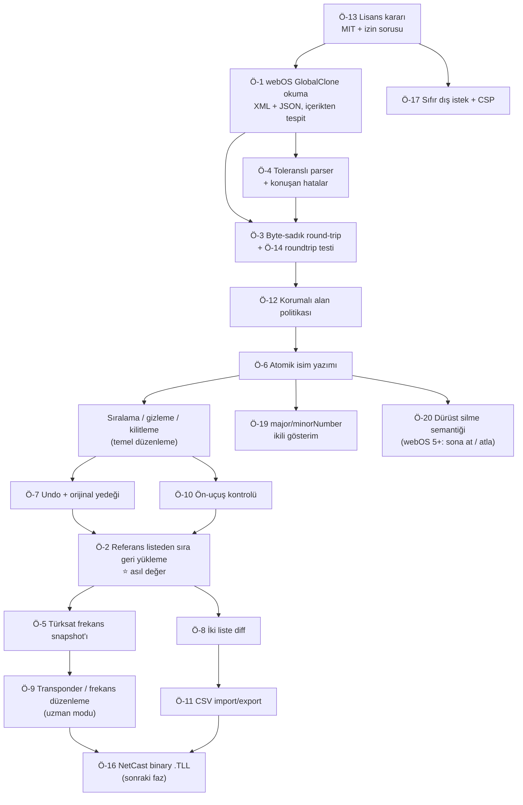

# 🔭 scm-editor (LG TV Kanal & Frekans Editörü) — Geliştirme Tarama Raporu

**Tarih**: 2026-08-17 · **Proje Tipi**: Statik, sunucusuz tarayıcı uygulaması (yeni kurulacak) · **Sınıf**: Orta

> **Bu rapor bir yeşil alan (greenfield) taramasıdır.** `~/Projects/scm-editor` şu an boş. Referans olarak verilen `iltekin/scm-editor` (Samsung) reposu klonlanıp koduna hakim olunmuş, LG tarafı ise ChanSort'un kaynak kodu ve gerçek örnek dosyaları üzerinden doğrulanmıştır. Öneriler "mevcut kodu iyileştir" değil, **"neyi, hangi sırayla inşa et"** biçimindedir.

---

## 0. Önceki Taramadan Bu Yana

Önceki defter yok — bu ilk tarama. `scm-editor_tara.json` bu koşuyla oluşturuldu.

---

## 1. Bugünkü Durum ve Bağlam

**Proje henüz yok.** Amaç: iki LG TV'nin (ev) kanal listesini, Türksat 3A'nın emekliye ayrılması sonrası bozulan sıralamayı düzeltmek için USB üzerinden düzenleyebilmek. Referans alınan `iltekin/scm-editor`, Samsung `.scm` ve Tizen `.zip` formatları için **tamamen tarayıcıda çalışan, sunucusuz** bir editör; mimarisi (statik dosyalar, build yok, dosya cihazdan çıkmıyor, format başına ayrı dizin + hub sayfası) doğrudan devralınabilir. Ancak **kanal adı/sırası/silme düzenliyor; frekans veya transponder katmanına hiç dokunmuyor.**

**Bağlamın aciliyeti:** Türksat 3A **15→16 Ağustos 2026 gecesi 00:00'da** kapandı; 573 TV + 215 radyo, aynı yörünge konumunda (42°E) kalarak Türksat 4A, 5B **ve 6A**'ya dağıtıldı. Bugün geçişin **T+1. günü**. Yani bu araç için hem talebin hem de veri kararsızlığının zirvesindeyiz.

---

## 2. 🌍 Dış Dünya: Benzer Projeler ve Pazar

### 2.1 Benzer GitHub Projeleri

| Proje | ⭐ | Son commit | Platform | Öne çıkan özellikleri |
|---|---:|---|---|---|
| [PredatH0r/ChanSort](https://github.com/PredatH0r/ChanSort) | 1061 | 2025-06-12 | C# / **Windows-only** | 28 loader, 20+ marka, 11 dil, referans listeden sıralama, favoriler, .bak yedek. **208 açık issue** |
| [Woodstock99/ChanView](https://github.com/Woodstock99/ChanView) | 0 | 2026-06-16 | Python + tkinter | Yalnız LG webOS; **LCN yazabilen tek araç**; favoriler; arayüz sadece Almanca |
| [shihsaway/lg-channel-editor](https://github.com/shihsaway/lg-channel-editor) | 0 | 2026-04-21 | **Tarayıcı**, tek HTML | LG `.TLL`; hard delete, taşıma, rename (`nameToHex`); **lisanssız**; undo/favori yok |
| [ChannelEditor/LG](https://github.com/ChannelEditor/LG) | 0 | **2024-07-15** | **Tarayıcı**, ~7 KB | Fiilen demo: sadece sil + taşı + indir. 4 günde yazılıp terk edilmiş |
| [Motivesoft/lgTLL](https://github.com/Motivesoft/lgTLL) | 0 | 2026-04-03 | Node.js, **MIT** | GlobalClone XML parse + `hexVchName` çözücü. **Lisansı kod alıntılamaya uygun tek LG projesi** |
| [aycanozarpaci/philips-channel-edit](https://github.com/aycanozarpaci/philips-channel-edit) | 0 | 2026-08-16 | **Tarayıcı**, MIT | Philips. **Mimari şablonumuz**: byte-sadık yama, CRC16 yeniden hesaplama, undo/redo, roundtrip testi, vendor'lanmış bağımlılık |
| [mimez/samychan](https://github.com/mimez/samychan) | **17** | **2020-12-21** | **PHP — sunucu** | Kategorinin en popüler "web" aracı; **dosyayı sunucuya yüklüyor**, 6 yıl bakımsız, LG yok |
| [iltekin/scm-editor](https://github.com/iltekin/scm-editor) (referans) | 11 | 2026-08-16 | **Tarayıcı** | Samsung `.scm` + Tizen `.zip`. TR/EN. **Lisans yok** |

### 2.2 Özellik Karşılaştırma Matrisi

*(her hücre reponun README'sine veya indirilen kaynak koduna bakılarak dolduruldu; `?` = bakılamadı)*

| Özellik | **Hedefimiz** | ChanSort | ChanView | lg-channel-editor | ChannelEditor/LG | philips-ch-edit | iltekin/scm-editor |
|---|:--:|:--:|:--:|:--:|:--:|:--:|:--:|
| LG desteği | ✅ | ✅ | ✅ | ✅ | ✅ | ❌ | ❌ |
| Tarayıcıda, kurulumsuz | ✅ | ❌ | ❌ | ✅ | ✅ | ✅ | ✅ |
| macOS'ta yerel | ✅ | ❌ *(VM)* | ✅ | ✅ | ✅ | ✅ | ✅ |
| Dosya cihazdan çıkmıyor | ✅ | ✅ | ✅ | ✅ | ✅ | ✅ | ✅ |
| Yeniden adlandırma | ✅ | ✅ | ✅ | ✅ | ❌ | ✅ | ✅ |
| Sıralama / numara | ✅ | ✅ | ✅ | ✅ | ✅ | ✅ | ✅ |
| Toplu silme | ✅ | ✅ | ✅ | ✅ | ✅ | ❌ *(format izin vermiyor)* | ✅ |
| Arama / filtre | ✅ | ✅ | 🟡 | ✅ | ❌ | ✅ | ✅ |
| Favori listeleri | 🟡 *(yalnız webOS 2-4)* | ✅ | ✅ | ❌ | ❌ | ✅ | ❌ |
| **Referans listeden sıra uygulama** | **✅** | ✅ | ❌ | ❌ | ❌ | 🟡 *(json düzen)* | ❌ |
| **İki liste diff** | **✅** | 🟡 *(yan yana)* | ❌ | ❌ | ❌ | ❌ | ❌ |
| **Frekans / transponder düzenleme** | **✅** | ❌ *(README açıkça hariç)* | 🟡 *(LCN)* | ❌ | ❌ | ❌ | ❌ |
| Yeni transponder ekleme | 🟡 *(ileride)* | ❌ | ❌ | ❌ | ❌ | ❌ | ❌ |
| CSV import + export | ✅ | 🟡 *(panoya kopyala)* | ❌ | ❌ | ❌ | 🟡 *(yalnız çıktı)* | ❌ |
| Geri al (undo) | ✅ | ❌ | ❌ | ❌ | ❌ | ✅ | ❌ |
| Otomatik yedek | ✅ | ✅ *(.bak)* | ❌ | ❌ | ❌ | 🟡 | ❌ |
| Checksum/CRC işleme | 🟡 *(NetCast fazında)* | ✅ | ❌ | ❌ | ❌ | ✅ | ✅ *(kayıt checksum'ı)* |
| Çoklu dil | ✅ TR/EN | ✅ 11 | ❌ *(DE)* | 🟡 2 | 🟡 2 | 🟡 | ✅ 2 |

**Matristen çıkan boşluklar:** ① incelenen 9 aracın **hiçbirinde gerçek iki-liste diff yok**; ② undo yalnız 1 araçta var, pazar lideri ChanSort'ta hiç yok; ③ **frekans/transponder düzenleme kimsede tam yok** — ChanSort README'de açıkça dışlıyor; ④ tam CSV import/export hiçbirinde yok; ⑤ **"tarayıcı + LG + olgun"** kombinasyonu fiilen mevcut değil (iki LG tarayıcı projesi de 0★, lisanssız, biri terk edilmiş demo).

### 2.3 Kullanıcılar Ne İstiyor

Aşağıdaki her satırın kaynağı açılıp okundu. Sıralama, **bağımsız kaynak sayısına** göre.

| # | Tema | Bağımsız kaynak | Bizim projeye yansıması |
|---:|---|---:|---|
| 1 | **Dosya tanınmıyor / boş açılıyor** | 10 | Toleranslı + passthrough parser, net hata mesajı ([#481](https://github.com/PredatH0r/ChanSort/issues/481) webOS 7.5: *"XML içinde JSON"* → ChanSort hata veriyor; [#446](https://github.com/PredatH0r/ChanSort/issues/446), [#436](https://github.com/PredatH0r/ChanSort/issues/436) *"dosya TV'de çalışıyor ama editör reddediyor"*) |
| 2 | **Liste sonradan bozuluyor** | 6 | Byte-sadık round-trip; [#446](https://github.com/PredatH0r/ChanSort/issues/446): *"dosyayı hiç değiştirmesem bile TV'ye geri gönderince tüm transponder envanteri kayboluyor"* |
| 3 | **Windows gerekiyor** | 6 | Tarayıcı bu temanın tamamını sıfır sürtünmeyle çözüyor (ChanSort README: macOS = Parallels/UTM ile VM) |
| 4 | TV reddediyor / import tutmuyor | 5 | Ön-uçuş kontrolü + roundtrip doğrulama |
| 5 | **TV'nin kendi arayüzü zaten sıralayamıyor** | 4 | Talebin kökü. [AVForums](https://www.avforums.com/threads/lg-c2-cant-move-dtv-channels-from-programme-manager.2455698/): LG C2 / webOS 23'te *"elimde sadece kilit ve atla var, taşı veya sil yok"* |
| 6 | Yeniden adlandırma tutmuyor | 3 | İsim + hex + uzunluk alanlarının **atomik** yazımı ([#270](https://github.com/PredatH0r/ChanSort/issues/270)) |
| 7 | Favoriler düzenlenemiyor | 3 | webOS 5+'ta favoriler export'a hiç dahil değil → **dürüstçe sınır olarak belirt** |
| 8 | **Kanal ekleme / frekans düzenleme** | 2 | En büyük farklılaştırıcı; [#255](https://github.com/PredatH0r/ChanSort/issues/255) ve [#230](https://github.com/PredatH0r/ChanSort/issues/230) yanıtsız kapatılmış |
| — | "Arayüz karmaşık" | ~0 | **Çürütüldü**: ChanSort SourceForge puanı 22 değerlendirmede 4,6/5. UX'i tek satış argümanı yapma |
| — | "Checksum hatası" | 0 (LG için) | **Çürütüldü**: webOS GlobalClone'da checksum YOK; CRC32 yalnız eski NetCast binary `.TLL`'de |

**Türkiye'ye özgü, geçiş sonrası (16 Ağustos 2026) kanıt:**

> *"tkgs olan uydularda bile işkence haline dönüşecek güncelleme. kendi isteğinize göre sıraladığınız kanalların yerleri değişecek. tekrar sıralama yapmanız gerekecek."*
> — ekşi sözlük, 16.08.2026 00:46 · K3

> *"Bende 670 küsur kanal çıktı. En başta rus kanalları var. Samsung H serisi uyumlu kanal listesi bulmak lazım yoksa 2 günü tv karşısında kanal ayarlamakla geçireceğiz."*
> — DonanımHaber Forum, 16.08.2026 16:16 · K3

İkinci alıntıdaki *"en başta rus kanalları var"* ifadesi, Türksat'ın resmî tablosundan bağımsız olarak doğrulandı: Rus paketi T3A 11012H'den **T6A 11727V**'ye taşınmış, yeni transponder olduğu için tarama sırasında listenin başına düşmüş.

**Topluluğun bugünkü çözümü = bizim rakibimiz:** kullanıcılar birbirlerine hazır `GlobalClone00001.TLL` / `.scm` dosyaları paylaşıyor ([LG TV Sıralı Kanal Listesi, 16 Ağustos 2026](https://forum.donanimhaber.com/lg-tv-sirali-kanal-listesi-16-agustos-2026--163910379), 7 gün ömürlü geçici hostlarda). Bu çözüm **kullanıcının kendi sıralamasını korumaz — başkasının sıralamasını dayatır.** Boşluk tam burada.

### 2.4 Modern LG'de (2022-2024) dosya çıkarma hâlâ mümkün mü? — **Evet, doğrulandı**

Bu, projenin uygulanabilirliğini belirleyen sorudur ve somut kanıtla kapandı.

| Tarih | Model | Firmware / webOS | Sonuç |
|---|---|---|---|
| **2024-11-23** | **LG 43NANO82T6B** | Firmware 23.20.65, **webOS24 9.2.0-22** | ✅ **Export + düzenleme + import — hepsi çalıştı** ([#430](https://github.com/PredatH0r/ChanSort/issues/430)) |
| 2024-08-09 | LG OLED C4 (2024) | — | ✅ Çalıştı |
| 2024-08-07 | LG OLED55B39LA (B3, 2023) | — | ✅ "Worked flawlessly" |
| 2024-05-30 | — | webOS 6.4.0-1703 | ✅ Çalıştı |
| **2026-04-01** | LG65NANO917NA | webOS 5.6.1-6 (en güncel) | ❌ **Export tamam, import listeyi BOZDU** (iki farklı tarama yöntemiyle de) |

**Üç çıkarım:**

1. **Özellik kaldırılmamış.** Menü yolu: *Tüm Ayarlar → Kanallar → Kanal Kopyalama* (LG resmî e-guide, TR: *"TV'nizin kanal listesi bilgilerini, bağlı bir USB aygıtına aktarın… Uydu modelleri için"*). Dosya adı hâlâ `GlobalClone00001.TLL`.
2. **Format webOS 5 → 6 → 22/23/24 → 7.x boyunca tek soy.** ChanSort'un LG koduna **2023-12'den beri hiç dokunulmamış** — çünkü gerekmemiş. ChanSort'un `fileformats.md`'sindeki "webOS 2-5" ifadesi **eskimiş dokümantasyon**, gerçek sınır değil.
3. **Kırılgan olan export değil, import.** Her başarısızlık raporu import aşamasında. Bu, aracın risk profilini belirliyor: orijinali her zaman geri yüklenebilir tut, dosya adını zorla, USB uyarısını göster.
4. **ChanSort 17 aydır güncellenmedi** (son sürüm 2025-03-08) — alanda gerçek bir boşluk var, özellikle webOS 25 ve sonrası için. *(2025-2026 modeller / webOS 25 hakkında ne olumlu ne olumsuz tek bir rapor bulunamadı — bu bir boşluk, bir sonuç değil.)*

**⚠️ TKGS — açık kalan tek belirsizlik:** LG uydu kurulumunda operatör olarak "Türksat TKGS" seçildiğinde bir de **"Çalışma Şekli: Esnek / Sabit"** seçimi çıkıyor. Üç bağımsız Türkçe kaynak (2018, 2023, **2026-07** tarihli) aynı şeyi söylüyor: **"Esnek" seçilmezse sıralama kilitleniyor.** Bu, ChanSort'un marka-nötr uyarısıyla birebir örtüşüyor: *"Bir sağlayıcı/ülke/uydu listesi seçerseniz liste ön-sıralı gelir ve TV export+import sonrası kararsız davranır. Her zaman 'yok/diğer/tümü' seçin."* İki bağımsız kaynak ailesinin aynı sonuca varması, tek başına K3 kaynakların taşıyamayacağı bir güven veriyor.

Ancak **"ChanSort ile sıraladım, TKGS güncellemesi sıralamamı ezdi/ezmedi" diyen doğrudan tek bir rapor bulunamadı** — ne olumlu ne olumsuz. Bu boşluk ürün riski olarak taşınmalı (bkz. Ö-10). İyi haber: LG parkının bir kısmında TKGS zaten yok (DonanımHaber, LG 49UF8507 sahibi, 16.08.2026: *"bende tkgs de yok."*), o cihazlarda risk sıfır.

### 2.5 Test korpusu — post-Türksat gerçek LG dosyaları mevcut

DonanımHaber'deki [16 Ağustos 2026 başlığı](https://forum.donanimhaber.com/lg-tv-sirali-kanal-listesi-16-agustos-2026--163910379) doğrulandı (2026-08-17 itibarıyla linkler HTTP 200, **indirilmedi, yalnız varlığı teyit edildi**):

| Dosya | Kaynak | Değer |
|---|---|---|
| `GlobalClone00001.TLL` — **963 kanal, ham** | LG **55QNED86A6A**, 2026-08-16 | **Ana altın örnek**: post-Türksat, TR, büyük, düzenlenmemiş |
| `GlobalClone00001.TLL` — 44 kanal, düzenlenmiş | aynı cihaz | Diff / round-trip testi |
| `xxLM620S-ZE00001.TLL` | LG LM serisi (2012), 2026-08-16 | **NetCast binary formatı**, post-Türksat — bu formatta örnek çok nadir |

Ayrıca GitHub'da ChanSort issue eklerinde 4 gerçek `.TLL` daha var; biri **kasten bozuk** (webOS 7.5.6, bakımcı teyitli: kapanış etiketi eksik) — hata yolu testi için ideal.

### 2.6 Türksat geçişi — araç tasarımını doğrudan bağlayan olgular

| Olgu | Değer | Katman |
|---|---|---|
| Emekli uydu / an | Türksat 3A, 15→16 Ağustos 2026, 00:00 | K1 |
| Yörünge konumu | **Değişmedi**, 42.0°E — çanak ayarı aynı | K1 |
| Hedef uydular | **T4A (501 kayıt) + T5B (108) + T6A (120)** — resmî duyuru uydu adı vermiyor; haberlerin yazdığı "sadece 4A ve 5B" **eksik** | K1 (Türksat'ın kendi tablosundan sayıldı) |
| Resmî frekans tablosu | `turksat.com.tr/uydu/yayincilik-hizmetleri/turksat-frekans-listesi` — 16 sayfa × 50 satır = **756 satır**, sütunlar: Kanal, Frekans, Pol, Kapsama, SR, FEC, **V-PID, A-PID**, Uydu | K1 |
| Resmî XLSX/PDF export | **BOZUK** — HTTP 500 `Veri alınamadı` (2026-08-17) → bağımlılık kurulamaz | K1 |
| Şebeke taraması | 12380 V / 27500 / 3-4 (TR+Avrupa) · 12423 H / 30000 / 3-4 (TR+Orta Asya) | K1 |
| ⚠️ Çelişki | Duyuruda **12380/12423**, tabloda **12379/12422** → **frekansla tam-eşitlik eşleştirmesi sessizce kırılır; ±2 MHz tolerans veya PID eşleştirme şart** | K1 |
| ⚠️ Çelişki | T3A hâlâ resmî listede 27 kayıtla duruyor (KingOfSat'ta 44). Bayat mı taşınmamış mı **doğrulanamadı** → "şüpheli" işaretle | K1/K2 |
| TKGS | Frekansı otomatik günceller, **kullanıcı sıralamasını korumaz** | K1 + K3 |
| Üretici firmware duyurusu | LG/Samsung'un bu geçişe özel resmî duyurusu **bulunamadı** | — |

---

## 3. 🎯 Önerilen Özellikler

### Ö-1: webOS GlobalClone desteği (XML + XML-içinde-JSON), içerikten format tespitiyle — 🔴 🏆 Quick Win

- **Ne**: Ürünün çekirdeği. `GlobalClone00001.TLL` dosyasını aç, kanalları listele, adlandır/sırala/gizle, geri yaz. Format **uzantıdan değil içerikten** tespit edilir: `<legacybroadcast>` varsa webOS 5-7 (JSON), `<TLLDATA>` varsa webOS 2-4 (XML), `<` ile başlamıyorsa NetCast binary (bu fazda "desteklenmiyor" de).
- **Neden**: LG'nin üç kuşağı **aynı dosya adını** kullanıyor — `GlobalClone00001.TLL` hem webOS 2-4 XML'i hem webOS 5+ JSON'u olabilir. Uzantıya bakan her araç bu yüzden patlıyor (dış araştırma, tema #1, 10 kaynak).
- **Nasıl (taslak)**: `lg-globalclone/` dizini (referans repodaki `samsung-scm/`, `samsung-zip/` desenini izle). Parser saf JS — LG'de SQLite yok, WASM gerekmiyor. webOS 5+ için: `<legacybroadcast>` ile `</legacybroadcast>` arasını al, XML-unescape et, JSON parse et, `channelList` ve `satelliteList[].TransponderList` üzerinde çalış; XML zarfın önü/arkası **byte olarak sakla** ve kaydederken aynen geri yapıştır.
- **Güven**: ✅ doğrulanmış (ChanSort `LgPlugin.cs` + gerçek `GlobalClone00201.TLL`/`GlobalClone00001.TLL` örnek dosyaları açılıp parse edildi) · **Skor**: E5×G3×K3 = **45**

### Ö-2: "Eski sıramı yeni listeye uygula" — referans listeden sıra geri yükleme — 🔴

- **Ne**: İki dosya yükle: (a) geçiş öncesi eski listen (veya bir CSV yedeği), (b) yeniden tarama sonrası yeni liste. Araç kanalları eşleştirip **eski numaralarını yeni listeye taşır**. Eşleşmeyenler ("yeni gelen", "kaybolan") ayrı bir panelde gösterilir.
- **Neden**: Kullanıcının gerçek problemi bu. TKGS zaten frekansı güncelliyor; **çözmediği tek şey kişisel sıralama** (ekşi 16.08.2026 + ChanSort discussion #207). Sadece frekans güncelleyen bir araç TKGS'nin kopyası olur. Topluluğun bugünkü çözümü (hazır liste indirmek) kullanıcının kendi sıralamasını korumaz.
- **Nasıl (taslak)**: Eşleştirme anahtarı önceliği: ① `SVCID`+`TSID`+`ONID` üçlüsü → ② kanal adı (normalize: büyük/küçük, Türkçe karakter, "HD"/"SD" son eki, boşluk) → ③ V-PID/A-PID → ④ **son çare** frekans, ±2 MHz toleransla. Frekansı asla birincil anahtar yapma (12380 vs 12379 kanıtı). Belirsiz eşleşmeler kullanıcıya onaylatılır.
- **Güven**: ✅ doğrulanmış (ihtiyaç: 2 bağımsız TR kaynağı + ChanSort'un `Editor.ApplyReferenceList`'i aynı problemi çözüyor; tarayıcı tabanlı hiçbir araçta yok) · **Skor**: E5×G3×K2 = **30**

### Ö-3: Byte-sadık round-trip garantisi — 🔴

- **Ne**: Hiçbir değişiklik yapılmazsa indirilen dosya girdiyle **byte bazında aynı** olur. Değişiklik varsa yalnız değişen alanın karakter aralığı yamalanır; dosya baştan üretilmez. Buna eşlik eden otomatik test: örnek dosyaları aç → hiçbir şey değiştirme → kaydet → `diff` boş olmalı.
- **Neden**: Şikayet temaları #2 ve #4'ün (toplam 11 kaynak) tek ortak kökü bu. [#446](https://github.com/PredatH0r/ChanSort/issues/446): *"dosyayı hiç değiştirmesem bile TV'ye geri gönderince tüm transponder envanteri kayboluyor."* `philips-channel-edit` bunu çözmüş ve README'sinde açıkça vaat ediyor — kanıtlanmış desen.
- **Nasıl (taslak)**: XML/JSON'u serialize edip yeniden yazma; orijinal metin üzerinde offset tabanlı yama. webOS 2-4 XML'inde ayrıca ChanSort'un keşfettiği biçim kuralları zorunlu: **BOM yok**, **CRLF**, girinti karakteri boş string, XML deklarasyonundan sonra **boş satır**, boş `<vchName>` yerine tek boşluk.
- **Güven**: ✅ doğrulanmış · **Skor**: E5×G3×K2 = **30**

### Ö-4: Toleranslı / passthrough parser + konuşan hata mesajları — 🔴

- **Ne**: Bilinmeyen alanları **anlamadan koru ve geri yaz**. Şema beklenmedikse tamamen durma: neyi tanıdığını göster, tanımadığını "salt okunur" işaretle, kullanıcıya "bu model doğrulanmadı, önce yedek al" uyarısı ver. Hata mesajı "geçersiz dosya" değil, "webOS sürüm 200 bekleniyordu, `<legacybroadcast>` bulunamadı; dosyanın ilk 200 baytı: …" olmalı.
- **Neden**: En büyük şikayet kümesi (10 bağımsız kaynak). ChanSort'un `.ini` tabanlı katı uzunluk eşlemesi bilinmeyen bir kayıt boyunda ([#446](https://github.com/PredatH0r/ChanSort/issues/446): *"length 252 için mapping yok"*) tamamen duruyor. Kullanıcı [#256](https://github.com/PredatH0r/ChanSort/issues/256): *"açık bir hata mesajı bile vermiyor"*.
- **Nasıl (taslak)**: JSON tarafında bilinen alanları tip-kontrollü oku, geri kalanı nesnede bırak ve `JSON.stringify` yerine **hedefli string yaması** yap (Ö-3 ile aynı mekanizma). Sürüm rozeti göster: "Model: OLED55GX6LA · CloneVersion 200 · 3453 kanal · 47 uydu".
- **Güven**: ✅ doğrulanmış · **Skor**: E5×G3×K2 = **30**

### Ö-5: Türksat resmî frekans tablosunun gömülü, tarih damgalı anlık görüntüsü — 🔴 🏆 Quick Win

- **Ne**: 756 satırlık resmî tabloyu (Kanal, Frekans, Pol, SR, FEC, V-PID, A-PID, Uydu) tek seferlik çekip **statik JSON olarak projeye göm**. Editörde "bu kanal Türksat'a göre şu an nerede?" sütunu ve "listemdeki frekansları resmî tabloyla karşılaştır" raporu. T3A'da kalan 27 kayıt **"şüpheli/bayat"** rozetiyle gösterilir.
- **Neden**: Kullanıcının "frekanslar değişti" problemine doğrudan cevap; ayrıca Ö-2'nin eşleştirmesini besler (PID'ler burada). Resmî XLSX/PDF export uçları HTTP 500 döndüğü için **çalışma zamanında çekmek güvenilmez** — gömülü snapshot doğru mimari.
- **Nasıl (taslak)**: `data/turksat-42e-YYYYMMDD.json` + UI'da "veri tarihi" rozeti. Sayfalama `?page=0..15`, 50 satır/sayfa, `items_per_page` yok sayılıyor; istek başına ~0,15 sn gecikme yeterli; HTML entity decode gerekli (`beIN H&amp;E`).
- **Güven**: ✅ doğrulanmış (16 sayfanın tamamı çekildi; `robots.txt` HTTP 404 → protokol düzeyinde kısıt beyan edilmemiş) · **Skor**: E4×G3×K3 = **36**
- ⚠️ **Hukuki not**: Türksat bu veri için açık bir kullanım lisansı yayınlamamış. Kişisel/ev kullanımı ve kaynak göstererek yayınlama makul; ticari dağıtım öncesi ayrıca değerlendir.

### Ö-6: İsim yazımında bağlı alanların atomik güncellenmesi — 🔴 🏆 Quick Win

- **Ne**: Kanal adı değiştiğinde **tüm bağlı alanlar tek işlemde** güncellenir. webOS 5+: `channelName` + `chNameBase64` (ham DVB string'in base64'ü, gerekirse `0x15` UTF-8 gösterge ön ekiyle). webOS 2-4: `vchName` + `hexVchName` + `notConvertedLengthOfVchName` + `lengthOfVchName`.
- **Neden**: Şikayet teması #6 (3 kaynak). [#270](https://github.com/PredatH0r/ChanSort/issues/270): *"ChanSort ismi TLL dosyasında iki yerde (HEX dahil) değiştirmeli. Ama değiştirmiyor."* Sonuç: kullanıcı ismi değiştiriyor, TV eski ismi gösteriyor. Türkçe karakterler ayrıca [#347](https://github.com/PredatH0r/ChanSort/issues/347)'de sorun çıkarmış.
- **Nasıl (taslak)**: Tek bir `setChannelName(ch, name)` fonksiyonu; başka hiçbir yerden isim alanına yazılmaz. Türkçe karakter testi zorunlu birim testi olsun (ç, ğ, ı, İ, ö, ş, ü).
- **Güven**: ✅ doğrulanmış · **Skor**: E4×G3×K3 = **36**

### Ö-7: Geri al / ileri al + otomatik orijinal yedeği — 🔴 🏆 Quick Win

- **Ne**: Tam undo/redo yığını. Ayrıca dosya açılır açılmaz orijinali bellekte tut ve "Orijinali indir" düğmesini her zaman görünür yap — kullanıcı yedek almayı unutsa bile geri dönebilsin.
- **Neden**: ChanSort'un `MainForm.cs` (4043 satır) ve `Editor.cs` dosyalarında **"undo" kelimesi 0 kez geçiyor** — pazar liderinde geri al yok. İncelenen 9 araçtan yalnız 1'inde (philips-channel-edit) var. Referans Samsung repo yedeği yalnız README uyarısı olarak bırakmış.
- **Nasıl (taslak)**: Komut nesnesi yığını (her düzenleme bir komut) — dosyanın tamamının kopyasını almaktan çok daha ucuz. `Ctrl/Cmd+Z` / `Shift+Ctrl/Cmd+Z`.
- **Güven**: ✅ doğrulanmış · **Skor**: E4×G3×K3 = **36**

### Ö-8: İki liste karşılaştırma (diff) — 🔴

- **Ne**: Eski ve yeni listeyi yan yana değil, **gerçek diff** olarak göster: kaybolan kanallar, yeni gelenler, frekansı değişenler, adı değişenler, numarası kayanlar. Türksat geçişi sonrası tam olarak sorulan soru bu.
- **Neden**: İncelenen **9 aracın hiçbirinde yok** (ChanSort'unki yalnız yan yana görünüm). Geçiş sonrası kullanıcının ilk sorusu "hangi kanalım kayboldu?" ([#3.6](https://www.donanimhaber.com/tv-kanallari-yarin-gece-turksat-4a-ya-tasiniyor-frekans-ayari--209320): Star TV, Kanal D, Show, NTV, CNN Türk SD yayını bıraktı — SD alıcı kullanıcıları için kanal **kalıcı** kayıp).
- **Nasıl (taslak)**: Ö-2'nin eşleştirme motorunu yeniden kullan; çıktıyı diff tablosu olarak render et. SD→HD eşleştirmesini ayrı bir kategori yap ("SD sürümü kapandı, HD karşılığı bulundu").
- **Güven**: ✅ doğrulanmış · **Skor**: E4×G3×K2 = **24**

### Ö-9: Transponder / frekans düzenleme ekranı — 🔴

- **Ne**: `satelliteList[].TransponderList` üzerinde frekans, symbol rate, polarizasyon, FEC, TSID/ONID düzenleme; ve "resmî Türksat tablosundan güncelle" toplu işlemi.
- **Neden**: Pazarın en büyük boşluğu. ChanSort README'de birebir: *"NOT supported: adding new transponders or channels / changing tuner related properties of channels (ONID, TSID, SID, frequency, APID, VPID, ...)"*. Talep var ama yanıtsız ([#255](https://github.com/PredatH0r/ChanSort/issues/255), [#230](https://github.com/PredatH0r/ChanSort/issues/230)).
- **Nasıl (taslak)**: webOS 5+ JSON'da alanlar düz metin — `{"frequency":10719,"symbolRate":27500,"polarization":"Vertical","TSID":11000,"ONID":318,"codeRate":1,"satelliteId":"0130"}`. Checksum yok. Kanal ile transponder bağı `tpId` string'i (ilk 4 hane satelliteId + 6 hane frekans) — **frekansı değiştirirsen `tpId`'yi de yeniden üretmen gerekir**, aksi halde bağ kopar.
- **Güven**: ✅ doğrulanmış (gerçek `GlobalClone200-inner.json` üzerinde alanlar görüldü) · **Skor**: E4×G3×K2 = **24**
- ⚠️ **Uyarı**: Bu, aracın en riskli özelliği. Varsayılan olarak kapalı/"uzman modu" arkasında olmalı ve büyük bir uyarıyla açılmalı.

### Ö-10: Ön-uçuş kontrol listesi (kaydetmeden önce) — 🔴

- **Ne**: İndirme butonuna basmadan önce doğrulanan kontroller: dosya adı orijinaliyle aynı mı, numara çakışması var mı, radyo kanallarında `majorNumber`'ın `0x4000` biti doğru mu, korumalı alanlara dokunuldu mu, roundtrip testi geçiyor mu. Ayrıca kullanıcıya statik hatırlatmalar: **≤32 GB FAT32 USB**, TV kurulumunda sağlayıcı/operatör listesi değil "Yok/Diğer + tam tarama".
- **Neden**: Şikayet teması #4 (5 kaynak). Üç somut, doğrulanmış kural: ① **dosya adı birebir `GlobalClone00001.TLL` kalmalı** — bir kullanıcı (Discussion #207, 2024-05-30) dosyayı PC'de yeniden adlandırdığı için import başarısız olmuş: *"Yalnızca orijinal adıyla çalışıyor."* ② USB **FAT32 ve tercihen ≤16 GB** — bakımcının teşhisi ([#481](https://github.com/PredatH0r/ChanSort/issues/481)): NTFS'te TV dosyayı çöp baytlarla ve kapanış etiketi olmadan yazıyor. ③ TV taraması **operatör/sağlayıcı listesiyle değil** "yok/diğer/tümü" + tam tarama ile yapılmalı — aksi halde liste ön-sıralı gelir ve export+import sonrası TV kararsız davranır. Bu üçüncü madde Türkiye'de TKGS "Sabit" moduna karşılık geliyor (bkz. §2.4).
- **Nasıl (taslak)**: `preflight.js` — saf fonksiyonlar dizisi, her biri `{seviye, mesaj}` döner. Kırmızı varsa indirme engellenir, sarı varsa onay istenir.
- **Güven**: ✅ doğrulanmış · **Skor**: E3×G3×K3 = **27**

### Ö-11: CSV import + export — 🟡

- **Ne**: Kanal listesini CSV olarak dışa aktar, düzenlenmiş CSV'yi geri içe aktar (numara ve isim sütunları uygulanır). Aynı zamanda Ö-2 için taşınabilir "sıra yedeği" formatı.
- **Neden**: Hiçbir araçta tam yok (en fazla panoya kopyalama veya tek yönlü çıktı). Bir blog yazarının 2013'ten beri savunduğu şey: kanal verisi aslında *"basitçe bir CSV dosyasında saklanıp düzenlenebilecek bir grup parametre"*. Excel'de 900 kanalı sıralamak, tarayıcıda sürüklemekten hızlı.
- **Nasıl (taslak)**: `;` ayraçlı, UTF-8 BOM'lu (Excel TR uyumu), sütunlar: `no;ad;servisTipi;frekans;pol;sr;SVCID;TSID;ONID;uydu`.
- **Güven**: 🟡 tek kaynak (talep tek K3 kaynağı; yokluk ✅ doğrulandı) · **Skor**: E3×G2×K3 = **18**

### Ö-19: `majorNumber` ve `minorNumber`'ı birlikte göster — 🔴 🏆 Quick Win

- **Ne**: Kanal tablosunda iki numara sütunu: `majorNumber` ve `minorNumber`. Farklı oldukları satırlar vurgulanır.
- **Neden**: **ChanSort'un bilinen körlüğü.** Bakımcının kendi teşhisi ([#418](https://github.com/PredatH0r/ChanSort/issues/418), 2024-07-23): *"TLL dosyasında `majorNumber` ve `minorNumber` diye iki ayrı numara saklanıyor. **ChanSort sadece majorNumber'ı kullanıyor, ama televizyonun menüsü görünüşe göre minorNumber'ı gösteriyor.** 39. kanala kadar ikisi aynı; 'Sat.1 HD'de major=40, minor=51."* Yani kullanıcı ChanSort'ta 40 görüyor, TV'de 51 görüyor ve "sıralama tutmadı" sanıyor — muhtemelen "sıralama sorunları" temasının (141 açık issue) bir bölümünün gerçek sebebi bu.
- **Nasıl (taslak)**: Tabloda iki sütun + "bu ikisi farklı, TV'de görünen numara sağdaki olabilir" uyarısı. Sıralama uygularken ikisini de yaz.
- **Güven**: ✅ doğrulanmış (bakımcının birincil beyanı + örnek dosya elde mevcut) · **Skor**: E4×G3×K3 = **36**

### Ö-20: webOS 5+'ta "silme" yerine dürüst "sona at / atla" semantiği — 🔴

- **Ne**: webOS 5+ dosyalarında "Sil" düğmesi olmasın. Onun yerine "Listeden çıkar (sona atılır)" ve "Atla (skip)" olsun; arayüz ne olacağını açıkça yazsın.
- **Neden**: ChanSort bakımcısının açıklaması (Discussion #207, 2025-04-29): *"webOS 5 için ChanSort kanal silmeye izin vermiyor. TV öngörülemez tepki veriyor — aynı transponder üzerindeki başka bir kanala geçtiğiniz anda silinen kanalları rastgele yerlere geri sokuyor. Bu kaosu önlemek için silme kapatıldı; numarası atanmamış kanallar listenin sonuna ekleniyor."* Bu, kullanıcıların "sildiğim kanallar geri geliyor" şikayetinin ([#20](https://github.com/PredatH0r/ChanSort/issues/20), 11 yıldır açık) tam açıklaması. Yanlış vaat vermek, aracın güvenilirliğini tek seferde bitirir.
- **Nasıl (taslak)**: Format kuşağına göre yetenek bayrağı (`canDelete: false` webOS 5+ için) ve UI'ın bunu okuması.
- **Güven**: ✅ doğrulanmış · **Skor**: E4×G3×K2 = **24**

---

## 4. 🔧 Kod ve Mimari Önerileri

### Ö-12: Korumalı alan politikası — "asla yazma" listesi — 🔴 🏆 Quick Win

- **Ne**: Yazıcı katmanında sabit bir izin listesi. webOS 5+'ta **yalnız** şunlar yazılır: `channelName`, `chNameBase64`, `majorNumber`, `skipped`, `locked`, `Invisible`, (opsiyonel) `audioPid`. Şunlara **asla dokunulmaz**: `disableUpdate`, `factoryDefault`, `deleted`. `userEditChNumber` / `userSelCHNo` varsayılan kapalı bir ayar arkasında.
- **Neden**: ChanSort kaynak kodundaki yazarın kendi deneysel notu (K1) birebir: `disableUpdate` için *"No-Go! Bu tüm listeyi bloke etti ve fabrika ayarlarına dönmeyi gerektirdi."* `userEditChNumber` için: bu bayraklar TV menüsünden numara değiştirilince set oluyor ve **sonraki import'ları engelliyor**. Bu, tek satırlık bir hatanın kullanıcının TV'sini fabrika resetine zorlayabileceği anlamına gelir.
- **Nasıl (taslak)**: `WRITABLE_FIELDS` sabiti + yazma fonksiyonunda `if (!WRITABLE.has(key)) throw`. Test: yasak alana yazma denemesi hata fırlatmalı.
- **Güven**: ✅ doğrulanmış · **Skor**: E5×G3×K3 = **45**

### Ö-13: Lisans netleştirme (fork mu, sıfırdan mı?) — 🔴 🏆 Quick Win

- **Ne**: Başlamadan önce iki hukuki soruyu çöz: ① `iltekin/scm-editor` reposunda **hiç lisans dosyası yok** → varsayılan "tüm hakları saklı", yani fork etmek/kod almak teknik olarak izinsiz. Yazara (repo sahibi, X üzerinden ulaşılabilir) sor veya kodunu almadan yalnız **mimari deseni** taklit et. ② ChanSort **GPLv3** — kodunu veya `ChanSort.Loader.LG.ini` offset dosyasını kopyalarsan projen de GPLv3 olmak zorunda; **öğrenilen olguları** (alan adları, offsetler, hangi alanın yeniden hesaplanacağı) kendi kodunla yazmak bulaşmaz.
- **Neden**: ✅ Doğrudan doğrulandı: her iki repoda da `LICENSE` dosyası yok; ChanSort'ta lisans yalnız `readme.md` metninde beyan edilmiş (GitHub API `license: null`). Bu, sonradan düzeltilmesi pahalı olan bir karardır.
- **Nasıl (taslak)**: Kendi projene başından MIT koy. LG formatı için MIT lisanslı [Motivesoft/lgTLL](https://github.com/Motivesoft/lgTLL)'den kod alıntılamak serbest — GlobalClone XML parse + `hexVchName` çözücü içeriyor.
- **Güven**: ✅ doğrulanmış · **Skor**: E4×G3×K3 = **36**

### Ö-14: Regresyon test korpusu + roundtrip testi — 🔴

- **Ne**: Gerçek `.TLL` örnekleri (kendi iki TV'nden + topluluktan) üzerinde otomatik test: aç → hiçbir şey değiştirme → kaydet → byte-eş mi? Ardından: numarayı değiştir → kaydet → tekrar aç → değer doğru mu?
- **Neden**: ChanSort'un 18 model serisi klasöründe `.TLL.in`/`.TLL.out` çiftleri var — ama GPL. Kendi korpusun olmadan "bu model destekleniyor mu" sorusuna asla cevap veremezsin, ve şikayet teması #1'in (10 kaynak) tekrar etmesi kaçınılmaz olur.
- **Nasıl (taslak)**: `node tools/roundtrip-test.js` (philips-channel-edit'in 84 testlik deseni). İlk korpus: kendi iki LG'nden alınan dosyalar + DonanımHaber'de 16 Ağustos 2026'da paylaşılan LG listesi (izin alarak).
- **Güven**: ✅ doğrulanmış · **Skor**: E4×G3×K2 = **24**

### Ö-15: Format eklentisi mimarisi (hub + dizin başına editör) — 🟡

- **Ne**: Referans repodaki hub deseni: kök `index.html` marka/format seçimi, `lg-globalclone/`, `lg-netcast/`, (ileride) `samsung-scm/` ayrı dizinler. Ortak kod (`shared/`): undo yığını, tablo bileşeni, i18n, CSV, diff motoru.
- **Neden**: Referans repoda bu ayrım **yarım kalmış**: kök `app.js` (1172 satır) ile `samsung-scm/app.js` (1190 satır) arasında yalnız **35 satır fark** var — yani kökte ölü bir kopya duruyor. Aynı hatayı tekrarlama; ortak kodu baştan `shared/`e al.
- **Güven**: ✅ doğrulanmış (diff çalıştırıldı) · **Skor**: E3×G3×K2 = **18**

### Ö-16: NetCast binary `.TLL` desteği (sonraki faz) — 🟢

- **Ne**: 2009-2014 LG modelleri için bloklu binary format.
- **Neden**: Kapsamı genişletir ama **çok daha zor**: DVB-S bloğunun 5 alt bloğunun her biri için CRC32 (poly 0x04C11DB7, standart zlib), allocation bitmap, kanal bağlı listesi (linked list), transponder `first/last/count` alanlarının tutarlılığı, boş slotların `0xFF` ile doldurulması, ve symbol rate'in **global ölçek faktörü** (bazı firmware'lerde 2× veya 0.5× yazılıyor; tek kayda bakarak doğru okunamıyor, tüm tablo taranmalı).
- **Güven**: ✅ doğrulanmış · **Skor**: E3×G3×K1 = **9**

---

## 5. 🔐 Güvenlik Önerileri

### Ö-17: "Dosya cihazdan çıkmaz" iddiasının kanıtlanabilir olması — 🔴 🏆 Quick Win

- **Ne**: Sıfır dış istek: CDN yok, Google Fonts yok, analytics yok. Tüm bağımlılıklar `vendor/` altında yerel. Sayfaya sıkı bir `Content-Security-Policy` meta etiketi koy (`default-src 'self'; connect-src 'none'`) ve README'de "DevTools → Network sekmesini açıp kendiniz doğrulayın" de.
- **Neden**: Bu, pazardaki en net farklılaştırıcı. Kategorinin en popüler "web tabanlı" aracı (SamyCHAN, 17★) aslında **PHP sunucu uygulaması** — dosyayı sunucuya yüklüyor. Yeni bir Samsung tarayıcı editörü ise jsDelivr CDN'ine bağımlı, yani çevrimdışı çalışmıyor ve üçüncü tarafa istek atıyor. Referans repo bunu doğru yapmış (sql.js vendor'lanmış) — devral.
- **Güven**: ✅ doğrulanmış · **Skor**: E4×G3×K3 = **36**

### Ö-18: Tek kanonik adres + taklit siteye karşı koruma — 🟡

- **Ne**: Yalnız bir yayın adresi (GitHub Pages), README'de büyük harflerle belirt, indirilecek `.exe` olmadığını vurgula.
- **Neden**: ChanSort'ta 2026-05-22'de açılan [#480](https://github.com/PredatH0r/ChanSort/issues/480): *"chansort.org adresindeki güvenilmeyen bir site projeyi taklit ediyor… site sahibi bu linkleri istediği an zararlı dosyalarla değiştirebilir."* Kurulum gerektirmeyen bir araç bu risk sınıfını **yapısal olarak** ortadan kaldırıyor — bunu pazarlama argümanı yap.
- **Güven**: 🟡 tek kaynak (tek issue, ama K1) · **Skor**: E3×G2×K3 = **18**

> Tekil bug/açık avı bu raporun işi değil. Kod yazıldıktan sonra `/denetle` çalıştırılmalı.

---

## 6. 💡 Yenilikçi / Cesur Fikirler

- **"Sıra tarifi" (order recipe) dosyası.** Kullanıcının sıralaması dosyadan bağımsız, küçük bir JSON olarak dışa aktarılsın (`[{ad, SVCID, TSID, ONID, hedefNo}]`). Bir sonraki geçişte, marka/model değişse bile aynı sıra yeniden uygulanabilir. Bu, "hazır liste paylaşma" kültürünü **sıralama paylaşma** kültürüne çevirir — ve paylaşılan şey kişisel veri değil, sadece tercih.
- **Türksat geçişi için özel sihirbaz.** Tek amaçlı bir akış: "Eski listeni yükle → yeni taramanı yükle → sıranı geri al → indir." Genel editör yerine bu üç adımı öne çıkarmak, geçiş dönemi kullanıcısı için dönüşümü çok artırır.
- **Yeni kanal ekleme.** webOS JSON'da `channelList`e yeni girdi eklemek teorik olarak mümkün (checksum yok). Hiçbir araç yapmıyor, iki issue yanıtsız kalmış. Yüksek riskli ama gerçekten yeni — önce tek bir kanalla, kendi TV'nde denenmeli.
- **Keşfedilebilirlik ürünün parçası.** Okunan **hiçbir** forum başlığında (AVForums 2020/2023/2025, DonanımHaber, SourceForge) web tabanlı bir seçenekten söz edilmiyor; herkes "ChanSort kullan (Windows)" diyor. İyi araç yazmak yetmiyor — bu başlıklarda var olmak gerekiyor.

---

## 7. Değerlendirildi ama Önerilmedi

| Fikir | Neden elendi |
|---|---|
| ChanSort'u fork etmek / C# kodunu JS'e port etmek | GPLv3 bulaşır; ayrıca 28 loader'lık yük tek kişi + AI ekibi için orantısız. Olguları öğren, kodu yazma |
| `iltekin/scm-editor`'ü doğrudan fork etmek | Repoda **lisans dosyası yok** → varsayılan "tüm hakları saklı". İzin alınmadan fork riskli (bkz. Ö-13) |
| SQLite/WASM (sql.js) kullanmak | LG'de SQLite **yok** — üç format da binary/XML/JSON. WASM yalnız NetCast binary fazında düşünülebilir, o da gerekmez |
| Checksum motorunu öncelikli yapmak | webOS GlobalClone'da checksum **yok**; CRC32 yalnız eski NetCast binary `.TLL`'de. LG için erken optimizasyon |
| webOS 5+ için favori listesi düzenleme | Favoriler webOS 5'ten itibaren **export edilen veriye hiç dahil değil** — dosyada olmayan şey düzenlenemez. webOS 2-4 için mümkün |
| Sunucu tarafı "hazır liste" servisi / kullanıcı listelerini barındırma | "Dosya cihazdan çıkmaz" konumlanmasını yok eder; ayrıca Türksat verisinin ticari dağıtımı hukuken belirsiz |
| Çalışma zamanında Türksat sitesinden frekans çekmek | Resmî XLSX/PDF uçları HTTP 500; ayrıca tarayıcıdan CORS engeli ve "dış istek yok" vaadinin ihlali. Gömülü snapshot doğru çözüm |
| "Arayüzü ChanSort'tan daha basit yapmak"ı ana satış argümanı yapmak | **Çürütüldü**: ChanSort'un SourceForge puanı 22 değerlendirmede 4,6/5. Acı nokta kullanılabilirlik değil, **format kapsamı ve güvenilirlik** |
| Sıfır kesintili "TV'yi ağ üzerinden kontrol et" entegrasyonu | webOS'un kanal listesi API'si halka açık değil; USB akışı zaten çalışıyor. Orantısız |

---

## 8. 🗺️ Yol Haritası

| Sıra | Öneri | Öncelik | Skor | Bağımlılık |
|---:|---|:--:|---:|---|
| 1 | Ö-13 Lisans netleştirme | 🔴 🏆 | 36 | — |
| 2 | Ö-1 webOS GlobalClone desteği | 🔴 🏆 | 45 | — |
| 3 | Ö-12 Korumalı alan politikası | 🔴 🏆 | 45 | Ö-1 |
| 4 | Ö-4 Toleranslı parser + hata mesajları | 🔴 | 30 | Ö-1 |
| 5 | Ö-3 Byte-sadık round-trip | 🔴 | 30 | Ö-1 |
| 6 | Ö-14 Regresyon test korpusu | 🔴 | 24 | Ö-3 |
| 7 | Ö-17 Sıfır dış istek + CSP | 🔴 🏆 | 36 | — |
| 8 | Ö-6 Atomik isim yazımı | 🔴 🏆 | 36 | Ö-12 |
| 9 | Ö-19 major/minorNumber ikili gösterim | 🔴 🏆 | 36 | Ö-1 |
| 10 | Ö-20 Dürüst silme semantiği (webOS 5+) | 🔴 | 24 | Ö-1 |
| 11 | Ö-7 Undo + orijinal yedeği | 🔴 🏆 | 36 | temel düzenleme |
| 12 | Ö-10 Ön-uçuş kontrolü | 🔴 | 27 | temel düzenleme |
| 13 | **Ö-2 Referans listeden sıra geri yükleme** | 🔴 | 30 | Ö-7, Ö-10 |
| 14 | Ö-5 Türksat frekans snapshot'ı | 🔴 🏆 | 36 | Ö-2 |
| 15 | Ö-8 İki liste diff | 🔴 | 24 | Ö-2 |
| 16 | Ö-9 Transponder/frekans düzenleme | 🔴 | 24 | Ö-5 |
| 17 | Ö-11 CSV import/export | 🟡 | 18 | Ö-8 |
| 18 | Ö-15 Format eklentisi mimarisi | 🟡 | 18 | Ö-1 |
| 19 | Ö-18 Tek kanonik adres | 🟡 | 18 | — |
| 20 | Ö-16 NetCast binary .TLL | 🟢 | 9 | Ö-9, Ö-11 |

**Not**: Ö-2 ("asıl değer") listede 13. sırada çünkü altındaki güvenlik ağları (byte-sadık round-trip, korumalı alanlar, undo, ön-uçuş) olmadan çalıştırılması TV'yi riske atar. Ama ürünün *var oluş nedeni* odur — önceki adımlar onun altyapısıdır.

---

## 9. 🔬 Araştırma Metodolojisi

- **Sınıflandırma**: Orta (yeşil alan proje + bir referans repo + üç formatlı hedef ekosistem). Odak veya hızlı modu kullanılmadı.
- **Kod hakimiyeti**: `iltekin/scm-editor` klonlandı; 4567 satırlık JS okundu; örnek `.scm` dosyası açılıp ZIP kayıtları listelendi ve `TransponderDataBase.dat` **bu tarama sırasında ilk kez decode edildi** (45 byte kayıt; offset 13 frekans kHz, 17 symbol rate, 21 polarizasyon — 2442 kayıt üzerinde doğrulandı).
- **Paralel araştırma ajanı**: 4 (LG formatları / Türksat geçişi / rekabet analizi / modern LG export akışı). Toplam ~30 web araması + `gh api` sorgusu.
- **İkinci dalga**: yapıldı (modern LG export akışı ve TKGS etkileşimi).
- **Kaynaklar**: dört ajan toplamda **141 kaynak** ele aldı, **116'sını açıp doğruladı** (ajanlar arası örtüşme var — ChanSort deposu üç ajan tarafından da incelendi). Bunların 23'ü ChanSort'un birincil kaynak kodu ve gerçek örnek dosyaları (1 MB'lık `xxLA691S-ZA00004.TLL` ve 7,3 MB'lık webOS 5 JSON'u Python ile parse edildi), 16'sı Türksat resmî frekans tablosunun tam sayfalanmış hali (756 satır), 208'i ChanSort'un tam metin çekilip tema analizine sokulan açık issue'su.
- **Araştırma cache'i**: kullanılmadı (ilk koşu).
- **Kapsam boşlukları (şeffaflık)**:
  - **Reddit erişilemedi** (arama ve fetch engelli) → hiçbir Reddit iddiası rapora alınmadı, uydurulmadı.
  - `forum.uyducu.com.tr`, Samsung Members TR, `technopat.net`, `lgwebos.com`, `sanayigazetesi.com.tr` → HTTP 403.
  - LyngSat → bağlantı zaman aşımı (2 deneme). Bu araştırmada LyngSat'a dayanılmadı.
  - LG/Samsung'un bu geçişe özel resmî firmware duyurusu **arandı, bulunamadı**.
  - Türksat 6A için resmî yayın taşıma takvimi belgesi **arandı, bulunamadı**.
  - `estv.dev` (LG hotel TV JSON yazısı) → HTTP 500.
  - **TKGS ↔ elle sıralama etkileşimi**: "sıraladım, TKGS ezdi" veya "ezmedi" diyen doğrudan tek bir rapor **bulunamadı** (ne olumlu ne olumsuz). Ö-10'da ürün riski olarak taşınıyor.
  - **2025-2026 LG modelleri (webOS 25)**: kanal kopyalamanın çalıştığına ya da kaldırıldığına dair tek bir somut rapor **bulunamadı**. LG'nin resmî 2024 ABD kılavuzunda "Copy Channels" yok — ama ABD modellerinde DVB-S tuner de yok, dolayısıyla bu bulgu Avrupa/TR için **sonuçsuzdur**, olumsuz delil değildir.
- **Raporda gizlenmeyen çelişkiler**: hedef uydular (resmî duyuru isim vermiyor, haberler "4A/5B" diyor, resmî ham veri 6A'yı da gösteriyor) · T3A'nın hâlâ listede olması · 11225V'nin uydu atfında Türksat ile KingOfSat'ın uyuşmaması · duyurulan 12380/12423 ile tablodaki 12379/12422 arasındaki 1 MHz fark.

---

## 10. Kaynakça

Tüm erişimler **2026-08-17**.

**K1 — Birincil / resmî**
- https://github.com/PredatH0r/ChanSort — kaynak kodu: `LgPlugin.cs`, `Binary/TllFileSerializer.cs`, `Binary/DvbsDataLayout.cs`, `Binary/SatChannel.cs`, `Binary/SatTransponder.cs`, `Binary/SatChannelListHeader.cs`, `Binary/FirmwareData.cs`, `GlobalClone/GcXmlSerializer.cs`, `GlobalClone/GcJsonSerializer.cs`, `ChanSort.Loader.LG.ini`, `ChanSort.Api/Utils/Crc32.cs`, `source/fileformats.md`, `source/changelog.md`, `readme.md`
- ChanSort gerçek örnek dosyaları: `Test.Loader.LG/Binary/LA/xxLA691S-ZA00004.TLL.in`, `Test.Loader.LG/GlobalClone/GlobalClone00001.TLL`, `GlobalClone00201.TLL`, `GlobalClone200-inner.json`
- https://github.com/iltekin/scm-editor — klonlandı, kodu ve örnek `.scm` dosyası incelendi
- https://www.turksat.com.tr/kurumsal/basin-medya/haberler/turksat-televizyon-yayinlari-yeni-nesil-uydularimiza-tasiniyor
- https://www.turksat.com.tr/uydu/yayincilik-hizmetleri/turksat-frekans-listesi — 16 sayfa, 756 satır tamamı çekildi
- https://www.samsung.com/tr/support/tv-audio-video/how-to-set-channel-settings-on-samsung-f-series-tv/
- ChanSort issues/discussions: [#20](https://github.com/PredatH0r/ChanSort/issues/20), [#61](https://github.com/PredatH0r/ChanSort/issues/61), [#64](https://github.com/PredatH0r/ChanSort/issues/64), [#141](https://github.com/PredatH0r/ChanSort/issues/141), [#177](https://github.com/PredatH0r/ChanSort/issues/177), [#230](https://github.com/PredatH0r/ChanSort/issues/230), [#255](https://github.com/PredatH0r/ChanSort/issues/255), [#265](https://github.com/PredatH0r/ChanSort/issues/265), [#270](https://github.com/PredatH0r/ChanSort/issues/270), [#399](https://github.com/PredatH0r/ChanSort/issues/399), [#418](https://github.com/PredatH0r/ChanSort/issues/418), [#430](https://github.com/PredatH0r/ChanSort/issues/430), [#446](https://github.com/PredatH0r/ChanSort/issues/446), [#457](https://github.com/PredatH0r/ChanSort/issues/457), [#458](https://github.com/PredatH0r/ChanSort/issues/458), [#480](https://github.com/PredatH0r/ChanSort/issues/480), [#481](https://github.com/PredatH0r/ChanSort/issues/481), discussions [#207](https://github.com/PredatH0r/ChanSort/discussions/207), [#331](https://github.com/PredatH0r/ChanSort/discussions/331), [#380](https://github.com/PredatH0r/ChanSort/discussions/380); `readme_tr-TR.md`
- LG resmî e-guide (TR) — "Kanal Kopyalama": `kr.eguide.lgappstv.com/manual/w17_mr/dvb/Contents/settings/channel/copyprogrammes_e_a/tur/…`
- GitHub repoları (metadata + README + kod): [Woodstock99/ChanView](https://github.com/Woodstock99/ChanView), [Motivesoft/lgTLL](https://github.com/Motivesoft/lgTLL), [shihsaway/lg-channel-editor](https://github.com/shihsaway/lg-channel-editor), [ChannelEditor/LG](https://github.com/ChannelEditor/LG), [aycanozarpaci/philips-channel-edit](https://github.com/aycanozarpaci/philips-channel-edit), [lukama1/samsung-channel-list-editor](https://github.com/lukama1/samsung-channel-list-editor), [mimez/samychan](https://github.com/mimez/samychan), [vitalikp/scmedit](https://github.com/vitalikp/scmedit), [Sofien-Touati/LG-TLL-Cleaner-script](https://github.com/Sofien-Touati/LG-TLL-Cleaner-script), [srcshelton/webos-channel-tool](https://github.com/srcshelton/webos-channel-tool)

**K2 — İtibarlı ikincil**
- https://github.com/PredatH0r/ChanSort/wiki/LG
- https://en.kingofsat.net — 42E transponder görünümü (717 kayıt), `robots.txt`, `copyright.php`
- https://www.sozcu.com.tr/18-yillik-turksat-3a-donemi-sona-erdi-kanallarin-yeni-adresi-belli-oldu-p349838
- https://www.dunya.com/gundem/turksat-3a-devri-kapandi-kanallar-degisti-iste-yeni-frekanslar-haberi-836392
- https://www.memurlar.net/haber/1175540/turksat-3a-gorevini-devretti-saniyeler-icinde-1000-frekans-degisti.html
- https://www.ntv.com.tr/turkiye/galeri-turksat-3a-devri-kapandi-yeni-frekans-bilgileri-aciklandi-turksat-4a-yeni-uydu-ayari-nasil-yapilir-1737553
- https://www.donanimhaber.com/tv-kanallari-yarin-gece-turksat-4a-ya-tasiniyor-frekans-ayari--209320
- https://liveskills.net/ChannelEdit/english/ · https://macupdater.org/app_updates/appinfo/menssen.de.LG-Channel-Edit/index.html
- https://tr.wikipedia.org/wiki/Türksat_6A

**K3 — Anonim / tekil**
- https://eksisozluk.com/16-agustos-2026-tv-frekans-guncellemesi--8128792 (7 entry okundu)
- https://forum.donanimhaber.com/16-agustos-icin-samsung-kanal-listesi-olan-var-mi-scm-olarak--163910481
- https://forum.donanimhaber.com/lg-tv-sirali-kanal-listesi-16-agustos-2026--163910379
- https://forum.donanimhaber.com/lg-tv-kanal-listesi-duzenleme-programi-anlatimi--68017146
- https://sourceforge.net/projects/chansort/reviews/ (22 değerlendirme, 4,6/5)
- AVForums: [2530398](https://www.avforums.com/threads/channel-editing-software-for-samsung-or-lg-tvs-models-2024-and-onwards.2530398/), [2455698](https://www.avforums.com/threads/lg-c2-cant-move-dtv-channels-from-programme-manager.2455698/), [2326158](https://www.avforums.com/threads/lg-32lm6300-software-to-edit-channel-file-from-usb.2326158/), [2424549](https://www.avforums.com/threads/favourites-list-issue.2424549/)
- https://blog.techflaws.org/tag/chansort/
- https://www.technopat.net/sosyal/konu/turksat-3adan-4aya-gecis-ve-frekans-degisiklikleri-hakkinda.4160251/
- https://forum.donanimhaber.com/sunny-lg-dijitsu-onvo-tv-guncel-kanal-listesi-webos-tll-dosyasi-tkgs-sirali--161124024
- https://www.akliderbayi.com/blog/icerik/lg-tv-turksat-kanal-ayari (2026-07-14) · https://www.bertankilic.com/lg-webos-televizyonlarda-uydu-kurulumu-ve-kanal-siralama-nasil-yapilir/ (2023-03-04) · https://www.nuhazginoglu.com/tag/lg-webos-tkgs-uydu-ayari/ (2018-08-14) — LG TKGS "Esnek/Sabit" ayarı

---

## 💬 Özet

**🔭 Genel Bakış:** Bugün Türkiye'de LG televizyonu olan biri için ortada çalışan bir çözüm yok. Piyasadaki tek olgun program (ChanSort) sadece Windows'ta çalışıyor, Mac'te sanal makine istiyor ve kendi tanıtımında "frekans düzenleyemez" diye yazıyor. Tarayıcıda çalışan iki LG denemesi var, ikisi de kimsenin kullanmadığı, biri 2024'te yarım bırakılmış oyuncak projeler. En popüler "internetten çalışan" araç ise dosyanı aslında bir sunucuya yüklüyor ve altı yıldır güncellenmiyor. Yani **"kurulum yok, dosyan bilgisayarından hiç çıkmıyor, LG'yi düzgün destekliyor"** üçlüsü boşta duruyor — üstelik Türksat geçişi tam da dün gerçekleştiği için talebin en yüksek olduğu an.

**Asıl mesele frekans değil, sıralama.** Televizyon zaten yeni frekansları kendi buluyor (TKGS). Bulamadığı şey senin kendi kanal sıran: yeniden tarama yapınca 900 kanal karışık geliyor ve insanlar günlerini kumandayla kanal dizmekle geçiriyor. Şu an insanların çözümü birbirine hazır liste dosyası göndermek — ama o da senin sıranı değil, başkasının sırasını veriyor.

**Yapılabilir mi? Evet — doğrulandı.** 2024 model bir LG'de (webOS 24) kanal listesini USB'ye çıkarma, bilgisayarda düzenleme ve televizyona geri yükleme zincirinin baştan sona çalıştığına dair somut, tarihli bir kullanıcı raporu var. Dosya biçimi 2015'ten bugüne aynı soydan devam ediyor. Riskli olan çıkarma değil, geri yükleme adımı — bu yüzden araç her zaman orijinali geri verebilmeli.

**En önemli öneriler:**

- **Önce "eski sıramı yeni listeye uygula" özelliğini hedefle** — ürünün var oluş nedeni bu, ve hiçbir tarayıcı aracında yok. Az kod, çok değer.
- **LG'nin yeni nesil dosyası (2015 sonrası) aslında kolay** — içi düz metin, şifre yok, sağlama toplamı yok. Samsung'un binary formatını kırmaktan çok daha basit; işe buradan başla, eski model desteğini sonraya bırak.
- **Bir güvenlik kilidi şart: dosyadaki üç alana asla dokunma.** Bunlardan birine yazmak televizyonu fabrika ayarlarına döndürmeyi gerektiriyor — bu, ChanSort geliştiricisinin kendi kodunda not düştüğü, yaşanmış bir kaza.
- **"Hiçbir şey değiştirmezsen dosya bire bir aynı çıksın" garantisi ver.** Şikayetlerin en yıkıcı kümesi, dosya hiç değiştirilmese bile televizyona geri konunca listenin bozulması. Bunu baştan test ederek çözersen kalan sorunların çoğu ortadan kalkıyor.
- **Türksat'ın resmî frekans tablosunu (756 satır, PID'leriyle birlikte) projenin içine göm.** Böylece "hangi kanalım nereye taşındı" sorusuna araç kendisi cevap verebilir. Bir kereye mahsus iş.

*Kısacası: işe lisans kararı ve yeni nesil LG dosyasını okuyabilmekle başla, üstüne güvenlik ağlarını (bire bir kaydetme, korumalı alanlar, geri al) kur, asıl kazancı — sıra geri yükleme — ondan sonra topla.*

**Evdeki iki LG için ilk adım (kod yazmadan önce):** Her iki televizyonda *Tüm Ayarlar → Kanallar → Kanal Kopyalama* menüsünün olup olmadığına bak ve varsa listeyi FAT32 biçimli bir USB belleğe (tercihen 16 GB veya altı) çıkar. Çıkan dosyanın adı ve ilk satırları, hangi kuşakla çalıştığımızı kesinleştirir — ve o iki dosya aracın ilk test korpusu olur. Ayrıca uydu kurulumunda "Türksat TKGS" seçiliyse **Çalışma Şekli'nin "Esnek" olması** gerekiyor; "Sabit" ise sıralama zaten kilitli olduğu için hiçbir editör işe yaramaz.
