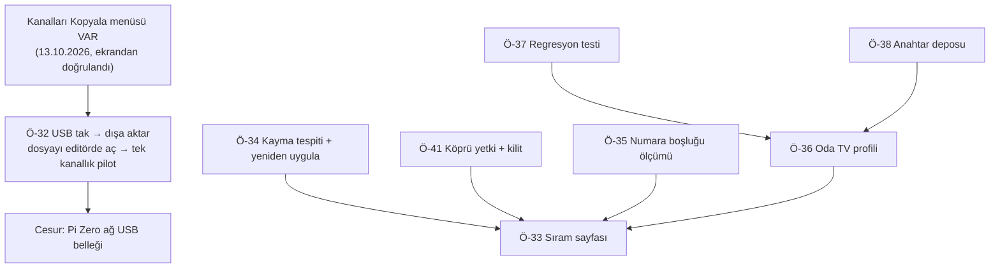

# 🔭 scm-editor (LG TV Kanal Aracı) — Geliştirme Tarama Raporu

**Tarih**: 2026-10-13 · **Proje Tipi**: Sıfır bağımlılıklı Node araçları + statik tarayıcı arayüzü · **Sınıf**: Orta · **Mod**: odak

> **Bu koşunun odağı tek bir soru:** *"Kanalları kumanda tuşu sürmeden, TV'nin veritabanına
> doğrudan/toplu yazarak sıralamanın daha pratik bir yolu var mı?"*
> Diğer alanlar kısaca geçildi. Önceki rapor: [`scm-editor_tara_20260817.md`](scm-editor_tara_20260817.md).

---

## 0. Önceki Taramadan Bu Yana

| Durum | Sayı | Notlar |
|---|---|---|
| ✅ Yapıldı | 18 (+3) | **Ö-29** ağdan sıralama — 13.10.2026'da salon TV'de çalıştı · **Ö-30** webOS 26 imzasız eşleştirme · **Ö-31** ekran görüntüsü + komut satırı aracı |
| 🔓 Açık | 16 (11 yeni, 1 kapandı) | Eskiden kalan 5 (Ö-8, 9, 11, 16, 18) + bu koşunun 10 yeni önerisi (Ö-32 … Ö-41) |
| 🚫 Vazgeçildi | 15 (+7) | Bu koşuda elenen 7 yol (Ö-42 … Ö-48) — bkz. §7 |

Ö-29 defterde 0 puanla ve ⚪ güvenle duruyordu ("TV ekranı görülemediği için körlemesine sürmek
riskli"). O engel bugün kalktı: TV ekran görüntüsü veriyor.

---

### 0.1 Rapor yazıldıktan sonra, aynı gece

Rapor tamamlandıktan sonra sürücü ilk kez büyük bir sıralamada (72 kanal, 55 taşıma) kullanıldı
ve raporda öngörülmeyen bir şey ortaya çıktı:

- **TV, seçilen kanalın transponderini kendiliğinden yeniliyor.** 7. taşımadan sonra bir
  transponderin 38 kaydı canlı yayından yenilendi (yayın kimlikleri değişti, servis eklendi),
  sürücü kanalı tanıyamayıp güvenli biçimde durdu. Listedeki kayıtların çoğu (663'ün 407'si)
  aynı bayat durumda. → **Ö-49** (yeni): kod yazıldı, 36 test geçti, **cihazda doğrulanmadı**.
- **Ö-35 kısmen cevaplandı:** taşıma numara kümesini koruyor; boşluklar yerinde kalıyor.
- **Ö-32'nin ilk yarısı tamam:** "Kanalları Kopyala" menüsü bu TV'de var.
- **Ö-37'nin önemi arttı:** kesinti tam olarak test edilmemiş bir yolda (beklenmeyen liste
  değişikliği) yaşandı.

Sıralama yarım kaldı (ilk 12 kanal yerinde); TV ardından bağlantı kabul etmeyi bıraktı.
Güncel durum: [`TODO.md`](TODO.md), kök neden: [`COZUMLER.md`](COZUMLER.md).

---

## 1. Proje Bugün Ne Durumda

Araç iki LG TV'nin uydu kanal listesini ağdan okuyor (SSAP), Türksat'ın resmî tablosuyla
karşılaştırıyor ve USB ile alınan `GlobalClone00001.TLL` dosyasını byte-sadık düzenliyor.
13.10.2026'da eksik parça eklendi: **TV'nin kendi Kanal Yöneticisi ağdan sürülüp sıralama
yapılabiliyor** — tuş gönder, ekranı gör, listeyi geri oku ve doğrula. Salon TV'de (OLED83G55LW,
webOS 26) 3 taşıma 43 saniyede, her biri doğrulanarak yapıldı. Sıralama için arayüz henüz yok
(yalnız komut satırı); oda TV'sinde (55SM8000PLA, webOS 4.5) bu yol hiç denenmedi.

### 1.1 Odak sorusunun cevabı — yedi yol, tek tablo

| # | Yol | Salon TV (webOS 26) | Oda TV (webOS 4.5) | Dayanak |
|---|---|---|---|---|
| 1 | SSAP'ta yazma ucu | ❌ Yok | ❌ Yok (beklenen) | ✅ Cihazda 17 aday `404` (webOS 25 **ve** 26) + 12 açık kaynak istemcinin hiçbirinde yok [K1] |
| 2 | **TV'nin düzenleyicisini ağdan sürmek** | ✅ **Çalışıyor** (~9 sn/taşıma) | ⚪ Denenmedi | ✅ Cihazda ölçüldü |
| 3 | USB ile liste dışa/içe aktarma | 🟡 **Menü var** (ekrandan doğrulandı); aktarımın kendisi USB takılmadan ölçülemedi | ✅ Yüksek kanıtla çalışır | ✅ Cihazda görüldü (menü) · ChanSort #207 [K2], LG kılavuzu [K1, eski] |
| 4 | Resmî Geliştirici Modu uygulaması | ❌ Resmî 15 Luna API'sinde kanal yok | ❌ aynı | LG geliştirici belgeleri [K1] |
| 5 | Otel/ticari ağ klonlama (`.tlx`) | ❌ `commercialmodel=false` | ❌ Tüketici modeli | ✅ Cihazda ölçüldü + LG kurulum PDF'i [K1] |
| 6 | Root'lu TV'ye ağdan doğrudan yazma | ❌ Güncel yazılımda kapalı görünüyor | ⚪ Muhtemelen mümkün — **araştırılmadı** | Tek araç README'si [K1-araç]; bkz. §9 kapsam boşluğu |
| 7 | "Ağa bağlı USB bellek" (Pi Zero) | ⚪ Gerçekçi, LG'de test edilmemiş | ⚪ aynı | Kernel belgesi + MagPi + teslausb [K1] |

**Sonuç:** Bugün elde, USB'siz ve doğrulanmış **tek** yol 2 numaradır ve çalışıyor. "Tek seferde
toplu yaz" isteğini karşılayabilecek tek gerçekçi aday 3 numaradır (USB). Raporun yazıldığı gece
ekrandan bakıldı: **Ayarlar → Genel → Kanallar → Kanalları Kopyala** bu TV'de var, içinde
"TV - USB" ve "USB - TV" seçenekleri duruyor (USB takılı olmadığı için gri). Yani yol kapalı
değil; geriye dosyayı gerçekten alıp denemek kalıyor (Ö-32). 1, 4 ve 5 numaralı yollar kapalı —
yeniden araştırılmasına gerek yok.

---

## 2. 🌍 Dış Dünya: Benzer Projeler ve Pazar

### Benzer GitHub Projeleri

| Proje | ⭐ | Son commit | Öne çıkan özellikleri |
|---|---|---|---|
| [PredatH0r/ChanSort](https://github.com/PredatH0r/ChanSort) | 1081 | 2026-10-08 | Windows masaüstü; LG GlobalClone (webOS 2-6 teyitli); referans listeden sıra uygulama. 2024-2026 sürüm notlarında LG'ye dokunulmamış |
| [robNice/lg-webos-channel-editor](https://github.com/robNice/lg-webos-channel-editor) | 0 | 2026-10-13 | **Ağdan okuyup yazan tek araç — ama root'lu TV şart.** Yedek, önizleme, onay; yalnız LG C2 / webOS 22'de denenmiş; "aktarım atomik değil, otomatik geri alma yok" |
| [shihsaway/lg-channel-editor](https://github.com/shihsaway/lg-channel-editor) | 0 | 2026-04-21 | Tarayıcıda çalışan TLL editörü; test listesinde webOS 5-6 modelleri |
| [srcshelton/webos-channel-tool](https://github.com/srcshelton/webos-channel-tool) | 1 | 2023-05-01 | Bash; numaraları kaydedip yeni taramaya uygular |
| [mertparlak-zima/lg-channel-import](https://github.com/mertparlak-zima/lg-channel-import) | 0 | 2026-09-29 | Türksat'a özel USB akışı; yalnız webOS 1.4'te ölçülmüş |

### Özellik Karşılaştırma Matrisi

*(Her hücre deponun README'sine/koduna bakılarak dolduruldu; "?" = belgede yazmıyor.)*

| Özellik | Bizim Proje | ChanSort | robNice | shihsaway | srcshelton |
|---|:---:|:---:|:---:|:---:|:---:|
| webOS 2-4 dosyası (XML) | ✅ ¹ | ✅ | ❌ | ✅ | ✅ |
| webOS 5+ dosyası (JSON) | ✅ ¹ | ✅ | ❌ | kısmi | ? |
| webOS 25/26'da cihazda doğrulanmış | ✅ (ağ yolu) | ? | ? | ? | ❌ |
| Ağdan okuma | ✅ | ❌ | ✅ (root) | ❌ | ❌ |
| Ağdan yazma — **root'suz** | ✅ | ❌ | ❌ | ❌ | ❌ |
| Ağdan yazma — root'lu TV | ❌ | ❌ | ✅ | ❌ | ❌ |
| TV menüsünü tuşla sürme + doğrulama | ✅ | ❌ | ❌ | ❌ | ❌ |
| Sıra şablonu uygulama | ✅ | ✅ | ✅ | ❌ | ✅ |
| Tarayıcıda çalışır | ✅ (editör) / ❌ (sıralama) | ❌ | ✅ (yerel) | ✅ | ❌ |
| Türksat resmî tablosuyla doğrulama | ✅ | ❌ | ❌ | ❌ | ❌ |

¹ Sentetik test dosyalarıyla; gerçek TV çıktısıyla henüz doğrulanmadı (README'de de böyle yazıyor).

**Okuma:** "Root'suz ağdan yazma" ve "menüyü tuşla sürüp doğrulama" satırlarında yalnız biz varız.
Üç ajan da bu birleşimin (tuş makrosu + ekran görüntüsü + liste geri okuma) yayımlanmış bir
emsalini aradı, **bulamadı** — parçalar ayrı ayrı biliniyor, birleşimi yeni.

### Kullanıcılar Ne İstiyor

- **Yeni LG'lerde "Taşı" düğmesi tarama moduna bağlı.** QNED87 ve G4 sahipleri düzenleyicide
  yalnız Kilitle/Atla gördüklerini yazıyor; C3'te ise taşıma çalışıyor. Ortak açıklama: operatör
  listesi (ya da TKGS "Sabit") seçiliyken taşıma kapalı. → Bizim salon TV'de Taşı var, yani
  uygun modda; ama sürücü bu ön koşulu **denetlemiyor** (Ö-34).
  [[avforums 2514229](https://www.avforums.com/threads/help-editing-channel-list-please.2514229/) K3,
  [avforums 2491418](https://www.avforums.com/threads/reorder-channel-number-move-channel-lg-c3.2491418/) K3]
- **"Sıraladım, günler sonra kendiliğinden karıştı."** Tekrarlayan şikâyet; sebep çoğunlukla
  otomatik liste güncellemesi. → En değerli özellik "bir kez sırala" değil, **"bozulunca tek
  tıkla geri getir"** (Ö-34). [[ChanSort #207](https://github.com/PredatH0r/ChanSort/discussions/207) K1/K2]
- **USB içe aktarımı kırılgan.** İçe aktarım reddi, "liste aynı kaldı", kanalların 0 numara
  alması raporları sürüyor (en yenisi 01.04.2026, webOS 5.6). Şartlar: FAT32 ≤16 GB, dosya adı
  değişmez, ülke eşleşmeli, operatörsüz tarama. → USB yolunu öneriyorsak ön-uçuş denetimi şart.
  [[ChanSort #207](https://github.com/PredatH0r/ChanSort/discussions/207), [#481](https://github.com/PredatH0r/ChanSort/issues/481) K1]
- **webOS 26 üçüncü taraf araçları kırdı.** Nisan-Ağustos 2026 arasında yayılan yazılım,
  kütüphanelerin ortak eşleştirme imzasını reddediyor; LG'den açıklama yok. → Bizde bugün
  düzeltildi (Ö-30). [[home-assistant/core #172703](https://github.com/home-assistant/core/issues/172703) K2]

---

## 3. 🎯 Önerilen Yeni Özellikler

### Ö-34: Sıra kayması tespiti + "sıramı yeniden uygula" — 🔴 🏆 Quick Win
- **Ne**: Kayıtlı sıra tarifini TV'nin o anki listesiyle karşılaştır; kayma varsa kaç taşıma
  gerektiğini göster, tek komutla geri getir. İlk taşımada "Taşı" düğmesi yoksa (TKGS Sabit modu)
  anlamlı hata ver.
- **Neden**: Dış bulgu — sıralamanın günler sonra bozulması en sık şikâyet. İç bulgu — mekanizma
  zaten kodda: planlayıcı "0 taşıma" dönüyorsa sıra yerinde demektir. Ayrıca cihazda ölçüldü:
  otomatik güncelleme ayarı ağdan **okunamıyor** (`settings/getSystemSettings` kanal kategorisi
  webOS 26'da `500`), yani kaymayı önceden bilemeyiz, ancak sonradan görebiliriz.
- **Nasıl (taslak)**: `tools/tv.mjs` içine `durum --tarif …` komutu (yalnız okur);
  `tools/net/lg-editor.mjs` içinde ilk taşıma başarısızsa ekran görüntüsünü kaydedip nedenini söyle.
- **Güven**: ✅ doğrulanmış · **Skor**: E4×G3×K3 = 36

### Ö-33: "Sıram" sürükle-bırak sayfası — 🔴
- **Ne**: Tarayıcıda TV'nin listesini göster; baş sırayı sürükleyerek kur, kaydet, planı (kaç
  taşıma, kaç dakika) gör, onayla ve canlı ilerlemeyi/TV ekranını izle. Aynı tarif iki TV'ye
  uygulanabilsin.
- **Neden**: İç analiz — sıralama bugün yalnız komut satırından. Aynı kanalın birden çok kopyası
  var (gerçek listede "TRT1 HD" 4 kez, toplam 80 kopya ad); ada göre seçim belirsiz, satır seçimi
  şart.
- **Nasıl (taslak)**: `web/sira.html` + `web/sira.js`; `tools/bridge.mjs`'e `plan`, `uygula`,
  `ilerleme`, `ekran` uçları. Eşleştirme mevcut `web/lib/order.js`, plan `web/lib/moveplan.js`.
- **Güven**: ✅ doğrulanmış · **Skor**: E5×G3×K2 = 30

### Ö-32: Salon TV'de "Kanalları Kopyala" ile dışa aktar, dosyayı editörde aç, pilot içe aktarım — 🔴
- **Ne**: Menünün varlığı 13.10.2026'da ekrandan **doğrulandı** (Ayarlar → Genel → Kanallar →
  Kanalları Kopyala; "TV - USB" / "USB - TV" seçenekleri USB takılı olmadığı için gri). Kalan iş:
  bir USB bellek takıp dışa aktarmak, dosyanın bizim editörde açıldığını görmek, içe aktarımı
  tek kanallık pilotla denemek.
- **Neden**: Toplu yazma isteğini karşılayabilecek tek gerçekçi aday bu ve webOS 25/26 için
  **ne olumlu ne olumsuz** tek bir kullanıcı raporu yok (ChanSort'ta C5/G5 hakkında tek satır
  bulunamadı). Dosya biçimi büyük olasılıkla webOS 5+ ile aynı ama bu bir tahmin; ancak gerçek
  dosya söyler. Menüyü ağdan sürebildiğimiz için fiziksel iş yalnız belleği takıp çıkarmak.
- **Nasıl (taslak)**: FAT32, ≤16 GB bellek. Menü adımları `tools/tv.mjs tus …` ile; dosya
  `fixtures/local/` altına (git'e girmez). İçe aktarım pilotu ayrı adım ve kullanıcı onayıyla;
  öncesinde dokunulmamış dışa aktarım kopyası saklanır.
- **Güven**: ✅ doğrulanmış (menü cihazda görüldü) · **Skor**: E4×G3×K2 = 24

### Ö-36: Oda TV (webOS 4.5) için tuş haritası profili — 🟡
- **Ne**: Sürücüdeki tuş tarifi yalnız webOS 26 için çıkarıldı. Oda TV'sinde ekran görüntüsünün
  çalıştığını doğrula, Kanal Yöneticisi'ni keşfet, tarifi "profil" olarak ayır.
- **Neden**: Kullanıcının isteği **iki** TV. Oda TV'si için USB yolu da yüksek kanıtlı; hangisi
  pratikse o seçilir.
- **Nasıl (taslak)**: `tools/net/lg-editor.mjs` içinde `PROFILLER = { webos26, webos4 }`; profil
  seçimi eşleşme türünden (`imzasiz` → 26) ya da `hello` yanıtındaki sürümden.
- **Güven**: 🟡 tek kaynak (ekran görüntüsü ucu eski sürümlerde belgelenmemiş) · **Skor**: E5×G2×K2 = 20

### Ö-35: Numara boşluklarını ölç, "Kanal Numaralarını Düzenle"yi keşfet — 🟡
- **Ne**: TV listesinde 128 numara boşluğu var (11→13, 17→20…). Boşluklu bölgede taşıma yapınca
  numaraların nasıl kaydığı ölçülmedi; mavi tuştaki "Kanal Numaralarını Düzenle" hiç açılmadı.
- **Neden**: Bugün garanti edilen şey **sıra**, tam numara değil. Kullanıcı "TRT Haber 22 olsun"
  derse bunu sağlayan ilkel henüz yok.
- **Nasıl (taslak)**: Tek taşımalık ölçüm (boşluğa komşu iki kanal) + mavi tuş ekranının keşfi.
- **Güven**: ✅ doğrulanmış (boşluklar listede görülüyor) · **Skor**: E3×G3×K2 = 18

### Ö-39: Çoklu seçimle blok taşıma — 🟢
- **Ne**: Düzenleyici çoklu seçimi destekliyor ("(N) seçili"). Ardışık bir grup tek taşımayla
  alınabiliyorsa taşıma sayısı düşer.
- **Neden**: 72 kanallık bir baş sıra bugün 51 taşıma (~8 dk). Hız tek pazarlık konusu.
- **Güven**: ⚪ çıkarım (blok davranışı denenmedi) · **Skor**: E3×G1×K2 = 6

*(Önceki koşudan açık kalanlar — yeniden araştırılmadı, sırada bekliyor: **Ö-8** iki liste
karşılaştırma · **Ö-9** transponder düzenleme · **Ö-11** CSV dışa aktarma.)*

---

## 4. 🔧 Kod ve Mimari İyileştirmeleri

### Ö-38: Eşleştirme anahtarını IP yerine cihaz kimliğine bağla — 🔴
- **Ne**: `.lgtv-clients.json` IP'ye göre anahtarlanıyor. Ev ağı 24.08.2026'da
  `192.168.1.0/24` → `10.63.0.0/24` taşınınca iki anahtar da "kayboldu"; bugün elle taşındı.
  Ayrıca yazılım sürümü webOS 26'da okunamıyor (`getCurrentSWInformation` → `401`).
- **Nasıl (taslak)**: Anahtarı model + seri no özetine bağla, IP'yi yalnız "son görülen adres"
  olarak tut. Sürümü `hello` yanıtındaki `deviceOSReleaseVersion` alanından oku.
- **Güven**: ✅ doğrulanmış (bugün yaşandı) · **Skor**: E3×G3×K3 = 27

### Ö-37: Sürücü ve planlayıcı için kalıcı regresyon testi — 🟡
- **Ne**: Planlayıcı 3000 rastgele benzetimle sınandı ama bu sınama **test dosyasına yazılmadı**.
  Sürücünün asıl değerli yolları (yanlış kanal seçilince durma, beklenmeyen sonuçta yeniden
  planlama, iki denemede vazgeçme) hiç test edilmedi — yalnız "her şey yolunda" yolu cihazda görüldü.
- **Nasıl (taslak)**: `tools/roundtrip-test.mjs`'e planlayıcı benzetimi + taşımaları modelleyen
  sahte bir TV nesnesiyle `applyHead` senaryoları (tuş kaybı, yanlış hedef, liste değişmedi).
- **Güven**: ✅ doğrulanmış (kodda görüldü) · **Skor**: E3×G3×K2 = 18

*(Açık kalan: **Ö-16** NetCast binary desteği.)*

---

## 5. 🔐 Güvenlik Önerileri

### Ö-40: Public depoda cihaz kimliği hijyeni — 🔴
- **Ne**: Depo herkese açık ve izlenen `data/tv-salon*.json` dökümlerinde TV'nin **seri numarası**
  var. Yeni dökümler ayrıca yerel IP'yi taşıyor; `tv/getACRAuthToken` ucu bir kimlik belirteci
  döndürüyor (bugün yalnız geçici dizinde kaldı).
- **Nasıl (taslak)**: Döküm yazılırken seri no / belirteç alanlarını maskele; `data/tv-*.json`'u
  `.gitignore`'a al (bugünkü döküm henüz izlenmiyor); geçmişteki üç dosya için karar kullanıcıda.
- **Güven**: ✅ doğrulanmış (`git grep serialNumber -- data` → 3 dosya) · **Skor**: E3×G3×K3 = 27

### Ö-41: Köprüye "TV'yi süren" uçlar eklenirken yetki ve kilit — 🔴
- **Ne**: Köprü bugün yalnız okuyor. Ö-33 ile birlikte TV'nin listesini **değiştiren** uçlar
  gelecek. Aynı anda iki sıralama koşarsa ikisi de aynı menüye tuş gönderir.
- **Nasıl (taslak)**: Yazan uçlar yalnız `127.0.0.1`'de açık olsun, `--lan` modunda erişim
  anahtarı zorunlu; TV başına tek iş kilidi; her uygulamadan önce yedek zorunlu (bugün komut
  satırında var, köprüde de olmalı).
- **Güven**: ✅ doğrulanmış (kodda görüldü) · **Skor**: E4×G3×K2 = 24

*(Açık kalan: **Ö-18** tek kanonik adres. Tekil hata avı bu raporun işi değil — `/denetle`.)*

---

## 6. 💡 Yenilikçi / Cesur Fikirler

- **"Ağa bağlı USB bellek" (Pi Zero 2 W).** Pi, TV'nin USB portuna bellek gibi görünür; içindeki
  disk imajı WiFi'den değiştirilir. Böylece USB yolu da temassız olur: TV menüsünü ağdan sür →
  dışa aktar → dosyayı bilgisayarda düzenle → içe aktar. Mekanik kernel belgesiyle, uygulama
  MagPi rehberi ve teslausb ile kanıtlı; tek bilinmeyen LG'nin bunu tanıması. Tuzaklar belli:
  aynı imaja iki taraftan yazılmaz (ayır → güncelle → yeniden sun), FAT32, ayrı besleme.
  **Ön koşul Ö-32** — menü yoksa bu fikir de boşa düşer.
- **Kanal güncellemeyi de sürmek.** Aynı kapalı döngü (tuş + ekran + liste) TKGS güncellemesini
  ya da yeniden taramayı başlatıp bitince sırayı geri getirebilir: "güncelle ve sırala" tek komut.
- **Ekran görüntüsünde metin okuma.** Sürücü bugün ekranı *görmüyor*, yalnız listeyi ve açık
  kanalı okuyor. Görüntüden menü durumunu okumak (macOS Vision) sabit beklemelerin yerine
  "ekran hazır mı" denetimi koyar ve beklenmeyen bir pencereyi yakalar.
- **Oda TV'sinde root'lu doğrudan yazma.** Bir araç bunu yapıyor (yalnız C2 / webOS 22'de
  denenmiş) ve eski TV için kapı açık görünüyor. Bu raporda **araştırılmadı** (bkz. §9); cihazın
  güvenlik yapısını değiştirdiği için karar ve uygulama kullanıcıya aittir.

---

## 7. Değerlendirildi ama Önerilmedi

| Fikir | Neden elendi |
|---|---|
| **Ö-42** SSAP'ta gizli bir yazma ucu aramaya devam etmek | Cihazda 17 aday `404` (webOS 25 ve 26); 12 açık kaynak istemcide yok; manifestteki 7 kanal izninin hiçbirinin uç karşılığı bulunamadı; `timer`/`user`/`weeCustom` servislerinin tek bir metod adı bile bilinmiyor. Hata `401` değil `404` — sorun izin değil, metodun yokluğu |
| **Ö-43** Salon TV için root'lu doğrudan yazma | Güncel yazılımda kapalı görünüyor; tek araç yalnız webOS 22'de denenmiş, "atomik değil, geri alma yok" diyor |
| **Ö-44** Otel/ticari ağ klonlama (`.tlx`, Pro:Centric) | TV `tv.hw.commercialmodel = false` bildiriyor (cihazda ölçüldü); mimari ticari modellere özgü |
| **Ö-45** Geliştirici Modu uygulamasıyla kanal API'si | LG'nin resmî Luna API listesi 15 kalem; kanal okuyan ya da yazan yok |
| **Ö-46** Hazır WiFi'li USB bellek satın almak | Pazar ölü: SanDisk Connect 2019'da, FlashAir desteği 31.03.2026'da bitti; MobileLite USB'de bellek gibi görünmüyor |
| **Ö-47** Ekran görüntüsünü video/ses kaydı için kullanmak | Cihazda ölçüldü: ~2,8 kare/sn, 960×540'a sabit (boyut/biçim parametreleri yok sayılıyor), ses yok |
| **Ö-48** LG ThinQ uygulamasıyla sıralama | Uygulamada kanal düzenleme özelliği bulunamadı |

---

## 8. 🗺️ Önerilen Yol Haritası

| Sıra | Öneri | Öncelik | Skor | Bağımlılık |
|---|---|---|---|---|
| 1 | Ö-34 Kayma tespiti + yeniden uygula | 🔴 🏆 | 36 | — |
| 2 | Ö-32 USB ile dışa aktar + pilot içe aktarım | 🔴 | 24 | USB bellek (FAT32, ≤16 GB) |
| 3 | Ö-40 Cihaz kimliği hijyeni | 🔴 | 27 | — (commit'ten **önce**) |
| 4 | Ö-38 Anahtar deposu + sürüm tespiti | 🔴 | 27 | — |
| 5 | Ö-37 Regresyon testi | 🟡 | 18 | — (Ö-36'dan önce) |
| 6 | Ö-35 Numara boşluğu ölçümü | 🟡 | 18 | — |
| 7 | Ö-41 Köprü yetki + kilit | 🔴 | 24 | Ö-33 ile birlikte |
| 8 | Ö-33 "Sıram" sayfası | 🔴 | 30 | Ö-34, Ö-41 |
| 9 | Ö-36 Oda TV profili | 🟡 | 20 | Ö-37, Ö-38; TV açık olmalı |
| 10 | Ö-39 Blok taşıma | 🟢 | 6 | Ö-37 |

---

## 9. 🔬 Araştırma Metodolojisi

- **Sınıflandırma**: Orta, **odak modu**. Odak dışı alanlar yeniden araştırılmadı; önceki
  defterin 30 günlük önbelleği dolmuştu (57 gün), odak alanı sıfırdan tarandı.
- **Paralel ajan**: 4 başlatıldı, **3'ü sonuç verdi**. İkinci dalga: yapıldı (2 hedefli kaynak
  ana akışta açıldı — root'lu yazma aracının ve bir Geliştirici Modu rehberinin README'si).
- **Kaynaklar**: üç ajan raporunda toplam **121 kaynak satırı** (ajanlar arası örtüşme var —
  ChanSort ve SSAP kütüphaneleri birden çok ajanda), **98'i açılıp doğrulandı**. En güçlü kısım
  SSAP envanteri: 59 kaynaktan 54'ü ham içeriğiyle okundu (12 istemcinin kaynak kodu dahil).
- **Cihaz ölçümleri (13.10.2026, OLED83G55LW)** — rapordaki "cihazda ölçüldü" ifadelerinin
  dayanağı: servis listesi (16 servis) · 17 yazma + 5 servis adayı yoklaması · ekran görüntüsü
  hızı ve parametre denemesi (6 biçim) · yapılandırma anahtarları (144 anahtar) · ayar servisi
  kanal kategorisi (`500`) · taşıma ilkeli (5 elle + 3 sürücüyle taşıma). Kanıt:
  `data/ssap-uc-kesfi.json`.
- **Kapsam boşlukları (şeffaflık)**:
  - **Root/exploit durumu araştırılamadı.** O konuyu inceleyen ajan modelin güvenlik filtresine
    takılıp sonuç vermeden durdu; filtre dolanılmadı, konu kapsamdan çıkarıldı. Tablodaki
    "muhtemelen mümkün / kapalı görünüyor" ifadeleri başka bir ajanın açtığı **tek bir** araç
    README'sinden yan bulgudur; bağımsız doğrulanmadı.
  - **Oda TV'sinde hiçbir ölçüm yapılmadı** (TV kapalıydı). O sütundaki her şey kaynak ya da
    çıkarımdır.
  - **webOS 25/26'da USB içe aktarımı**: ne olumlu ne olumsuz tek bir kullanıcı raporu
    bulunamadı. Menünün varlığını kaynaklar teyit edemedi; biz ekrandan gördük (var). Aktarımın
    çalışıp çalışmadığı hâlâ ölçülmedi. LG'nin resmî kılavuz sayfası TLS hatası yüzünden doğrudan
    açılamadı (iki arama özetinde aynı alıntı).
  - **TKGS'nin elle sıralamayı ezip ezmediği**: LG'ye özgü doğrudan kaynak yine bulunamadı
    (Ağustos koşusundaki boşluk sürüyor).
  - **LG'den resmî açıklama** (webOS 26 eşleştirme değişikliği): arandı, bulunamadı.
- **Raporda gizlenmeyen çelişkiler**:
  - *"Yeni eşleşme tam izin veriyor" ↔ "yazma izinleri geri gelmiyor"* — tanım farkı çıktı:
    imzalı katmandaki izinler geri gelmiyor (kütüphane bakımcısı teyit etti); "tam" diyenler
    kendi ihtiyaç duydukları işlevleri kastediyor.
  - *"Mevcut anahtarlar geçersizleşiyor" ↔ bizim ölçümümüz* — kaynaklar eski anahtarın imzalı
    manifestle reddedildiğini yazıyor; bizde Ağustos'ta alınan anahtar **imzasız** manifestle,
    ekranda yeni onay çıkmadan kabul edildi. İkisi çelişmiyor ama bizim sonuç tek cihazlık.
  - *Menü yolu* — bir araç sayfası webOS 22-24 için "Genel → Clone Product" diyor; başka hiçbir
    kaynakta geçmiyor, doğrulanmadı.
  - *USB klasörü* — eski bir Türkçe rehber kökte `LG_DTV` klasörü istiyor, diğer kaynaklar dosyayı
    köke koyuyor.

---

## 10. Kaynakça

Erişim tarihi tümü için 13.10.2026.

**SSAP yüzeyi ve webOS 26 eşleştirmesi**
- [aiowebostv `endpoints.py`](https://raw.githubusercontent.com/home-assistant-libs/aiowebostv/main/aiowebostv/endpoints.py) — K1
- [bscpylgtv `endpoints.py`](https://raw.githubusercontent.com/chros73/bscpylgtv/master/bscpylgtv/endpoints.py) · [`webos_client.py`](https://raw.githubusercontent.com/chros73/bscpylgtv/master/bscpylgtv/webos_client.py) · [`available_settings_G5.md`](https://raw.githubusercontent.com/chros73/bscpylgtv/master/docs/available_settings_G5.md) — K1
- [lgtv2 `pairing.json`](https://raw.githubusercontent.com/hobbyquaker/lgtv2/master/pairing.json) · [PR #51](https://github.com/hobbyquaker/lgtv2/pull/51) · [PR #52](https://github.com/hobbyquaker/lgtv2/pull/52) — K1
- [Connect SDK `WebOSTVService.java`](https://raw.githubusercontent.com/ConnectSDK/Connect-SDK-Android-Core/master/src/com/connectsdk/service/WebOSTVService.java) — K1
- [LGWebOSRemote `remote.py`](https://raw.githubusercontent.com/klattimer/LGWebOSRemote/master/LGTV/remote.py) · [PyWebOSTV `controls.py`](https://raw.githubusercontent.com/supersaiyanmode/PyWebOSTV/master/pywebostv/controls.py) — K1
- [home-assistant/core #172703](https://github.com/home-assistant/core/issues/172703) · [#179669](https://github.com/home-assistant/core/issues/179669) — K2
- [aiowebostv PR #719](https://github.com/home-assistant-libs/aiowebostv/pull/719) — K1 · [#728](https://github.com/home-assistant-libs/aiowebostv/issues/728) · [#718](https://github.com/home-assistant-libs/aiowebostv/issues/718) — K2
- [LGTVCompanion #351](https://github.com/JPersson77/LGTVCompanion/issues/351) · [#347](https://github.com/JPersson77/LGTVCompanion/issues/347) — K2
- [d-gubert/lgtv-remote `PROTOCOL.md`](https://github.com/d-gubert/lgtv-remote/blob/main/docs/PROTOCOL.md) — K3 (webOS 23 servis listesi; bizimkiyle birebir aynı)
- [spydey74/lg-webos-bsc](https://github.com/spydey74/lg-webos-bsc) · [Orishas/webostv-webos26-fix](https://github.com/Orishas/webostv-webos26-fix) — K3
- [LG Luna Service API listesi](https://webostv.developer.lge.com/develop/references/luna-service-introduction) · [Developer Mode uygulaması](https://webostv.developer.lge.com/develop/getting-started/developer-mode-app) — K1

**USB yolu ve benzer araçlar**
- [ChanSort deposu](https://github.com/PredatH0r/ChanSort) · [`fileformats.md`](https://raw.githubusercontent.com/PredatH0r/ChanSort/master/source/fileformats.md) · [`changelog.md`](https://raw.githubusercontent.com/PredatH0r/ChanSort/master/source/changelog.md) — K1
- [ChanSort Discussion #207](https://github.com/PredatH0r/ChanSort/discussions/207) — K1/K2 · [Issue #481](https://github.com/PredatH0r/ChanSort/issues/481) — K1
- [robNice/lg-webos-channel-editor README](https://raw.githubusercontent.com/robNice/lg-webos-channel-editor/main/README.md) — K1 (araç; ana akışta da açıldı)
- [hawshemi/lg-c5-webos25-region-change README](https://raw.githubusercontent.com/hawshemi/lg-c5-webos25-region-change/main/README.md) — K1 (araç; ana akışta da açıldı; kanal verisinden söz etmiyor)
- [shihsaway/lg-channel-editor](https://shihsaway.github.io/lg-channel-editor/) · [srcshelton/webos-channel-tool](https://github.com/srcshelton/webos-channel-tool) · [mertparlak-zima/lg-channel-import](https://github.com/mertparlak-zima/lg-channel-import) — K1 (araç)
- LG Pro:Centric kurulum kılavuzu, UT567H serisi (lg.com/us/business, belge no 206-4351; ajan indirip okudu, tam adres ajan raporunda kısaltılmış geçtiği için bağlantı verilmedi) — K1
- [avforums 2514229](https://www.avforums.com/threads/help-editing-channel-list-please.2514229/) · [2464680](https://www.avforums.com/threads/can-the-channels-be-re-numbered.2464680/) · [2491418](https://www.avforums.com/threads/reorder-channel-number-move-channel-lg-c3.2491418/) — K3
- [televizyon.com.tr — kanal sıralaması rehberi](https://televizyon.com.tr/rehber/kanal-siralamasi-duzenleme) — K2 · [akliderbayi — LG Türksat ayarı](https://www.akliderbayi.com/blog/icerik/lg-tv-turksat-kanal-ayari) — K3

**Ağ USB belleği ve otomasyon emsalleri**
- [Linux kernel — Mass Storage Gadget](https://www.kernel.org/doc/html/v6.12/usb/mass-storage.html) — K1
- [MagPi — Pi Zero W smart USB flash drive](https://magazine.raspberrypi.com/articles/pi-zero-w-smart-usb-flash-drive) — K1/K2
- [teslausb](https://github.com/marcone/teslausb) — K1
- [esp-iot-solution `usb_msc_wireless_disk`](https://github.com/espressif/esp-iot-solution/blob/master/examples/usb/device/usb_msc_wireless_disk/README.md) — K1
- [webOS TV CLI tanıtımı](https://webostv.developer.lge.com/develop/tools/cli-introduction) — K1 (push/pull komutu yok)
- [Home Assistant — LG webOS entegrasyonu](https://www.home-assistant.io/integrations/webostv/) — K1

---

## 💬 Özet

**🔭 Genel Bakış:** "Kanalları TV'nin belleğine tek seferde yazabilir miyiz?" sorusunun cevabı
bugün için **hayır** — LG böyle bir kapı bırakmamış, yeni yazılımda da yok; bunu hem kendi
televizyonunda ölçtük hem de bu işi yapan bütün açık kaynak araçların kodunda aradık. Ama asıl
istenen şey zaten çalışıyor: bilgisayar TV'nin kendi "kanal düzenle" ekranını uzaktan kullanıyor,
her adımı kontrol ediyor ve bunu başka hiçbir araç yapmıyor. Yavaş ama güvenli: kanal başına
yaklaşık 9 saniye.

**En önemli öneriler:**
- **Sıra bozulunca tek komutla geri getir** — insanların en çok şikâyet ettiği şey, günler sonra
  sıranın kendiliğinden karışması. Az emek, çok kazanç.
- **Salon TV'de "kanalları USB'ye kopyala" seçeneği var — bir bellek takıp dene** — menünün
  varlığı bu gece ekrandan doğrulandı; toplu yazma yolunun gerçekten çalışıp çalışmadığını
  ancak dosyayı alıp geri yüklemek söyler. Tek fiziksel iş belleği takmak.
- **Sürükle-bırak sayfası** — bugün sıralama yalnız komutla yapılıyor; asıl "kolay" hâli bu. Orta emek.
- **Seri numarasını herkese açık depodan çıkar** — değişiklikleri yayınlamadan önce yapılmalı. Az emek.
- **Oda televizyonu için ayrı keşif** — eski TV'nin menüsü farklı; ya aynı yöntem uyarlanır ya da
  o TV'de USB yolu kullanılır (orada USB'nin çalıştığına dair kanıt güçlü).

*Önce iki hızlı kazanç (yeniden uygulama ve menü kontrolü) yapılmalı; sürükle-bırak sayfası
onların üstüne kurulur, "ağa bağlı USB bellek" gibi büyük fikirler menü kontrolünün sonucuna göre
değerlendirilir.*
